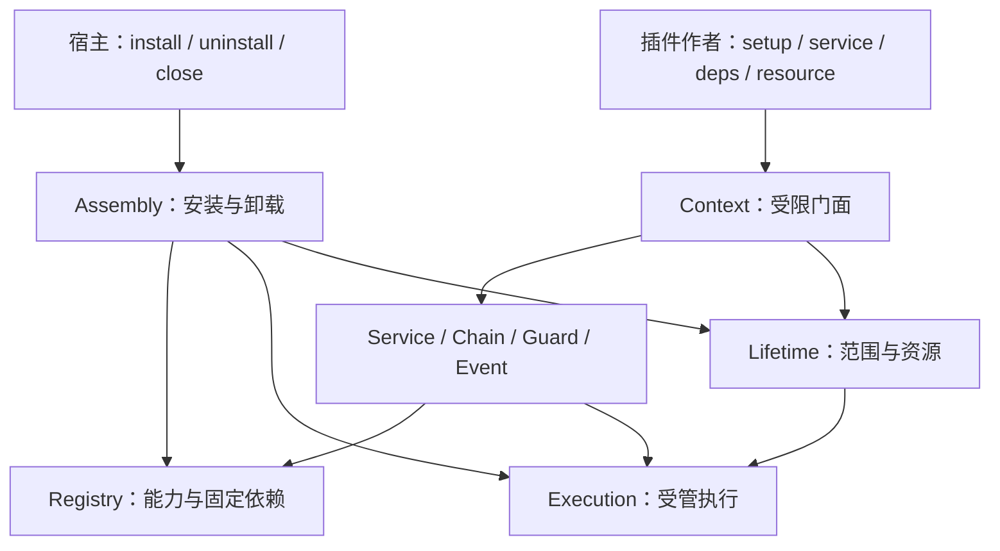
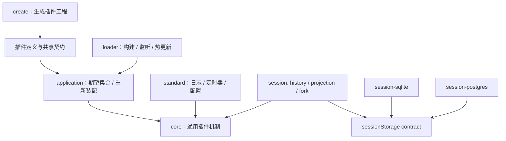

# 架构与边界

## 定位

core 是通用进程内插件底层系统。服务端、AI 应用和其他应用使用同一套装配、协作和生命周期机制。删除全部 AI 相关包后，core 仍能独立运行。HTTP、数据库、模型、工具、权限规则、持久化与可靠投递均属于外部插件。



## 平台分层



core、standard 和 application 保持平台无关。文件系统与 Bun 运行时依赖限制在 loader/create 及存储、执行适配器中，由平台边界门禁检查。standard 与 application 使用 core 公开入口；core/validation 子入口复用安全读取、JSON 快照、结果归一与错误构造，外层不复制验证协议。自动重新装配通过卸载旧实例再安装新实例实现，保持 core 的固定依赖语义；它不在 Registry 里修改现有消费者绑定。

sdk/src 保存公开入口与必要内部共享身份的纯数据清单，构建器和 Loader 共用，门禁验证清单与包导出一致。Loader 将 SDK 的包名、源码和构建路径归到同一稳定入口，业务私有实现独立打包并热更。SDK 源码变化要求进程重启；进程级有界指纹登记阻止新 Loader 绕过稳定代次。

Invocation的依赖按首次读取生成。同一Owner和固定绑定快照共用仅含名称及方法字符串的冻结布局，缓存使用弱键；未读取deps的调用不生成依赖上下文和服务门面。实际结算后首次读取仍返回具有声明方法的失效门面，方法报告cancelled；已经取得服务的门面继续报告service-unavailable。布局不持有token、Provider或Kernel，cleanup使用自己的旧依赖快照。

Execution对内核自有owner/scope/executor取消源复用弱键观察器，实际工作结束即移除其回调；每个Invocation仍有独立信号，不传播外部任意reason。父工作、外部调用信号及cleanup信号保持直接订阅，结算时解绑。源信号和业务自行登记的listener之间不保证逐工作注册顺序；结果由首次实际结算决定，超时或取消回执均不提前释放在途预算。

派生作者Context和依赖门面登记到原始能力的撤销链。工作实际结束或拥有者关闭时清空声明、token、取得的门面及上下文引用。私有WeakMap只记录能力到撤销登记端口，不能让外围获得内核写权限。

## 源码结构

```text
core/src/
  contracts/
  foundation/
  registry/
  execution/
  lifetime/
  assembly/
  mechanisms/
    services/
    chains/
    guards/
    events/
  context/
  index.ts
```

| 模块 | 唯一管理的全局事实 | 主要职责 |
| --- | --- | --- |
| Registry | 定义及反向引用、预留、消费者索引、处理器索引、服务缓存和 lease | 登记、固定绑定、发布、退休与撤销 |
| Execution | 实际工作、任务身份、等待图、执行计数、容量订阅 | 准入、调用、取消、第一次结果、实际结束与父子连接 |
| Lifetime | 作用域和拥有者索引、资源身份、释放观察 | 资源归属、关闭传播、清理与失败保留 |
| Assembly | 装配队列、实例引用、未收敛状态 | 规划、排序、暂存、提交、回滚与卸载选择 |
| 标准机制 | 各自的组合规则与事件队列 | 服务方法适配、next、allow/deny、FIFO 与载荷快照 |
| Context | 可撤销的外部门面 | 组合受限能力、命名作者接口、调用绑定与诊断快照 |

各状态工厂闭包保存 Map、Set、WeakMap 和计数，只返回冻结的命令与查询端口。Kernel 是只读组合对象，不暴露可替换的全局账本。内部 Scope、Owner、Provider、Work 等记录不从公开入口导出。Owner、Provider、Registration 和 Effect 为只读视图；生命周期状态由 Lifetime 私有闭包维护，提供者/绑定/登记/租约与 pins 由 Registry 维护，拥有者活动工作由 Execution 维护。其他模块通过命令请求变更，不能直接改写记录或集合。

普通作者通过 definePlugin、ctx.service、ctx.on、ctx.resource 和 call.deps 工作。宿主使用 Host 管理装配；Context 的 token/register/use 接口用于宿主与独立范围的显式接入。它们使用同一登记与执行机制，不创建代理插件或第二份运行时。

作者类型由同一份requires/provides/optional声明派生。PluginContext、PluginInvocation、PluginImplementations和PluginSpec接收单个Manifest类型；resource/task在值及错误类型后使用同一Manifest。definePlugin反向映射声明并用NoInfer隔离setup推断。命名能力按协议生成非泛型调用签名交集，声明为readonly函数属性，使完整Context及Pick最小接口都检查真实可调用域。同协议名称合并为名称联合；不同协议名称先收窄。只有确定存在的表、所有分支共有且严格协议确定的槽授予能力；服务联合先逐层重建严格函数属性再整体检查，额外字段检查覆盖全部分支。

作者包装以对象别名显式展开，避免同源泛型按原始方法双变关系短路：Context/Invocation与Omit相交，Task与CallOptions相交，依赖映射展开，Resource及PluginImplementations使用非分发条件结构。直接赋值、独立函数及预先声明的资源/任务/实现使用同一约束，不设置另一份类型身份。动态表与表内可选依赖保持相同约束。运行时只读取并冻结一次声明，不增加元数据或注册机制。

## 依赖方向

contracts 只依赖自身。foundation 只依赖 contracts 和自身；Registry、Execution 依赖这两层；Lifetime 可以使用 Execution；Assembly 可以协调 Lifetime 和 Execution。标准机制使用基础端口与受管执行。Context 是装配根，底层不能反向导入 Context 工厂。

lint 对实际运行时 import 建图，检查层级、循环、代码注释、class、平台依赖和私有测试导入。类型引用不构成运行时依赖。生产内核不导入外部包、Bun、Node、文件系统、网络或进程控制；浏览器目标构建验证平台边界。

## 作者声明与身份

requires、optional、provides 使用本地名称到共享 token 的映射。definePlugin 安全读取并冻结声明；install 再验证名称、定义身份、重复项、权限和预算。没有按字符串动态查找服务的注册表，也不通过 Proxy 或异步全局当前调用推断依赖。

插件定义可以复用，每次安装创建独立 Owner；可变状态在 setup 内建立。固定依赖绑定到具体 Provider 实例。optional 缺席也参与名称身份和预算，后续安装不会自动补齐。旧门面不重定向。

Registry 同时维护定义到引用、引用到定义和 Provider 到消费者的索引。释放只遍历对应引用；处理器捕获只遍历对应 Provider 和范围索引。投影在同一同步操作中更新，不通过后台修补维持一致性。

## 范围与权限

Scope 管可见性，Owner 管实例生命周期。服务只从本范围及祖先解析，不搜索兄弟和子范围。显式 shadow 才能遮蔽；撤销后保持 tombstone，不能悄悄回退祖先实现。

插件只能使用声明的依赖及自提供能力。子范围继承固定依赖与已声明能力，不扩大权限。子范围属于创建者；创建者关闭时连同关闭。Scope 是生命周期边界，不是不可信代码沙箱。

只有 Host 可以 install/uninstall/close 和等待范围关闭。插件只能 requestClose；不能在自己的调用栈内等待自身实际结束。应用实例创建、配置许可和进程调度由外部宿主协调。

## 装配事务

Assembly 先验证全部声明和依赖，按输入优先级稳定拓扑排序，再预留定义与提供者槽位。setup 按序受管执行，全部成功后同步发布；期间不能 await 提交的一半。

事件和 guard 在本插件 setup 前自动登记，仍属于本次暂存事务。service 只接受声明的服务实现全集，handle 只提供声明的 chain 终结者。on、middleware、guard 各自验证扩展类型，不能通过错误方法登记。

安装期间创建的子 Owner 加入同一事务参与集合。其 Provider 和处理器同批发布或回滚。未绑定的 staging 子范围不能通过 use、spawn 或 resource 执行未发布能力；合法激活工作的显式绑定可以传播事务权限，事件观察由内部调度器授权。

批量 service 先快照并验证所有实现与 options，检查全部冲突和整批资源容量，再同步登记。失败不会留下第一项提供者妨碍修正后重试。任意外部副作用不属于内核事务回滚保证。

同一 token 重新安装时，当前暂存事务的固定绑定可以使用新提供者；tombstone 只作用于无绑定的祖先回退查找，安装锚定（requires/optional 绑定）与既有固定绑定的解析不受其影响；旧服务门面不复活。

停止立即改变准入并发出取消，不排在装配队列后面。未收敛回滚保留资源和记录，标记 degraded 并拒绝新装配。子范围清理失败会保留父拥有者，不能误报回滚完成。

## 执行与资源

Work 分别记录 bodyOpen、outcome 和 actual。函数体结果确定后先关闭子工作准入，再排空已登记孩子，最后结算 actual。取消和超时可以先结束 outcome，不能释放仍在实际使用的预算、锁或资源。迟到微任务不能在 join 结束后再加入子工作。

Work 保存有效执行限制，由调用视图、执行者作用域和父工作的有效限制逐项取最严格值。嵌套服务、dispatch、spawn、wait 和 chain 的 next 使用同一限制快照。origin、executor 和 resourceOwner 只表达身份及所有权，改变执行者不能扩大已有调用预算。显式拥有者级后台任务仍从其自身作用域建立预算。

服务、chain 和 guard 的 Work 显式关联当前 Provider。Provider 停止时撤销业务执行，未进入的处理器不再运行；实际工作同时记入提供者拥有者的活动账本，卸载必须等实际排空。清理阶段使用独立信号和保留的固定依赖，不因业务能力停止而失去清理通道。

call.deps 与 call.dispatch 自动绑定执行者获准依赖、本次父工作、期限、取消和逻辑消费方。setup 的 ctx.deps 只属于激活工作，激活后失效。临时容量失败不缓存为永久依赖失败；成功门面仍由 Registry 缓存并可撤销。

ctx.resource 属于插件；call.resource 属于逻辑消费方。取得前先预留和登记，成功值先进入清理记录再交付。未交付的迟到成功立即受管回收；成功交付的资源随归属者关闭。清理失败保留资源与必要提供者。

资源清理使用独立信号和固定依赖。无显式清理父项时不回退业务 activation；清理服务调用保留实际资源拥有者身份。清理内部的受管工作也必须实际结束，才能释放资源和固定依赖。

普通 resource 返回值没有内核手动释放方法。提前释放使用明确范围，或使用带释放规则的登记回执。内核无法从裸值与 JavaScript 闭包推断所有使用；直接平台调用和未登记 Promise 由插件管理。

## 标准协作机制

Service 使用冻结且可撤销的方法门面，支持可选输入、输出和业务失败校验。实现只接收声明方法，消费者不能取得原始实现。

Chain 捕获稳定处理器计划，支持短路与顺序 next；Continuation 跟踪 then/catch/finally，禁止并发、迟到、未完成和未观察的失败。每层 next 挂在当前处理器工作。

Guard 按顺序聚合明确的 allow/deny，没有处理器时失败，不能默认放行。

外围在 Invocation 上增加业务字段时保留动态属性描述符与撤销门面，remainingMs 和 deps 在读取时才求值。执行完成后的门面保持失效语义，不保存剩余期限快照。

Event 保存有界 JSON 快照、每监听者 FIFO 与实际串行执行。队列只属于事件机制，其他登记不分配事件状态。容量不足时订阅实际工作释放通知；撤销会清除排队和容量等待。事件监听属于监听者，发出者是来源而非结构化父项。

## 可用性边界

动态安装、保护卸载和级联卸载属于内核。代码获取、模块导入、文件监听、版本选择、监督重启、强制结束与流量切换属于外部宿主。固定依赖的替换由宿主停止消费者、排空、替换并重新装配。

真实 Promise 不收敛时，内核保留账本并报告失败；进程或 Worker 隔离负责强制终止。内存事件不承诺持久化或可靠投递，core 不实现业务恢复协议。

诊断直接从私有账本复制纯元数据。foundation 负责身份和有界摘要，execution 保存任务标签并提供等待目标查询，lifetime 解释关闭剩余项，assembly 定位依赖阻塞，context 组合完整 inspect 快照。持久诊断和历史快照不保留运行对象或 token，也不新增索引、定时器和订阅。

## Session领域边界

session depends on the public session/storage service and owns domain validation, immutable history semantics and conversation projection. session-sqlite and session-postgres own their database resources and implement the same persistence contract through session-storage-sql. session-jsonl implements the same contract with local OS locks, append journals and atomic snapshots, without SQL dependencies. Other backends implement the public contract without SQL or domain implementation imports. Core owns dependency activation, invocation and shutdown. Public contracts preserve token identity across source/build assembly. See plugins/session/README.md.
