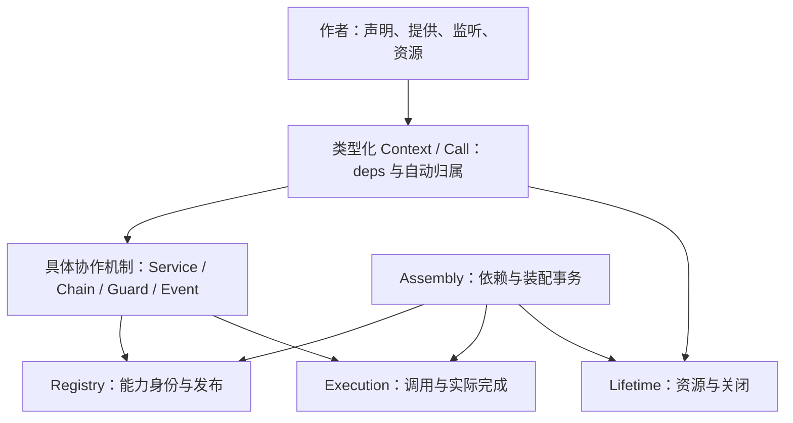

# 面向插件作者的内核设计与实现参考

状态：设计依据及已经落地的作者接口。当前使用方式以 [使用指南](../core/README.md)、[API](../API.md) 为准，运行证据见 [验收记录](../VERIFICATION.md)。

## 1. 核心结论

core 定位为通用插件底层系统。AI Agent、普通服务端应用和其他应用都是它的使用者；公共命名、默认配置和运行协议不以任何业务为前提。删除全部 AI 相关包之后，core 仍须独立安装插件、协调能力和管理资源。

外部简单和内部可靠是两个设计任务。推荐从作者任务反推运行时：普通作者主要理解“声明依赖、提供能力、注册处理器、创建受管资源”，不必理解 Owner、Work、Lease、Pin、HookPlan 或关闭状态机。

采用一个规范插件形态：definePlugin 对象声明，加一个 setup 函数。不同时支持函数、类、装饰器、callback done、async generator 等多套安装协议。

保留内部四个状态所有者与标准机制层，但它们是运行时实现细节，不能成为快速开始的章节结构。内核设计以三个可检验目标收口：

1. 普通插件代码短，并且参数自动推断；不用手工重复依赖解析与调用绑定。
2. 资源取得、取消、迟到成功和清理由一个安全操作负责，不要求作者手工拼接账本规则。
3. 安装失败、运行失败与关闭失败可观察，接口简化不删除实际追踪。

没有对所有应用都绝对最优的插件框架。本文推荐的是符合本项目 Result、显式依赖、受管调用和在线卸载目标的折中，而不是以某个框架的源码量作为最优证明。

## 2. 参考了哪些真实系统

以下资料来自官方文档和官方源码；Cordis 使用本地副本。远端 main 和 latest 是查阅时快照，不代表锁定发布版本；本文保留查阅来源，用于解释取舍，不声称已经实测第三方框架性能。

| 系统            | 实际核验的机制                                          | 借鉴                               | 不复制的场景假设                             |
| --------------- | ------------------------------------------------------- | ---------------------------------- | -------------------------------------------- |
| Cordis          | Registry.plugin、Fiber.effect、epoch/inertia、固定 Impl | 资源统一归实例，生命周期集中协调   | Proxy、原型访问推断、自动重装配              |
| Fastify / Avvio | register、插件树、关闭队列、Boot._addPlugin             | 一个简单安装入口，清楚的装配和诊断 | 不能把启动装配当运行时热插拔                 |
| Hapi            | register、dependency、expose、stop                      | 元数据与安装函数清楚，错误尽早报告 | 连接停止期限不等于所有扩展清理都有期限       |
| VS Code         | activate、subscriptions、Extension Host                 | 常见作者只处理激活和登记           | 普通 Disposable 不等待异步 dispose           |
| Pluggy          | hookspec、hookimpl、HookCaller、_multicall              | 契约与实现分开，固定组合策略       | 同步 hook 注册不等于异步工作和资源宿主       |
| Effect          | acquireRelease、Scope、finalizer                        | 分配和清理作为一个完整操作         | 不要求作者采用整套 DSL、generator 与 Fiber   |
| OSGi DS         | static/dynamic、reluctant/greedy、activate/deactivate   | 动态依赖必须明确策略，默认减少重绑 | 不复制复杂策略矩阵或要求作者处理每次重绑竞态 |

### 2.1 Fastify / Avvio

Fastify 的典型插件是接受实例和配置的安装函数，register 默认建立封装范围。Avvio 使用插件树和队列组织加载、ready 和关闭。借鉴它们的简短入口与装配树，而不是要求插件作者自己了解队列。[官方插件文档](https://fastify.dev/docs/latest/Reference/Plugins/)、[Avvio 机制说明](https://github.com/fastify/avvio#how-avvio-works)

Avvio 的 Boot._addPlugin 在 booted 后拒绝新增插件，onClose 通过反向入队组织关闭。因此它适合作为有序启动参考，不能证明本项目的在线装卸和实际工作排空已经解决。[官方 index.js](https://github.com/fastify/avvio/blob/main/index.js)

Fastify 的 override 可以创建子实例，也可以因插件包装标记跳过隔离。本项目继续采用显式 Scope 和 shadow，不用包装器暗改可见范围。[官方 plugin-override.js](https://github.com/fastify/fastify/blob/main/lib/plugin-override.js)

### 2.2 Hapi

Hapi 用插件名称、register、dependency 和 expose 描述能力与安装关系，并在初始化/启动前验证依赖。可借鉴元数据清晰、启动前拒绝不完整装配；不因此改成字符串名称自动连接。server.stop 的连接期限与扩展回调等待规则需要分别理解。[官方 API](<https://hapi.dev/api/21.x.x/#server.dependency()>)、[官方 Server 实现](https://github.com/hapijs/hapi/blob/master/lib/server.js)、[官方 Core 实现](https://github.com/hapijs/hapi/blob/master/lib/core.js)

### 2.3 VS Code

VS Code 的作者体验围绕 activate 和登记资源，subscriptions 让释放责任可见。它的官方类型同时明确普通订阅释放不等待异步 dispose；因此这里只学习简单入口，不采用其异步释放语义。Extension Host 的隔离和监督属于更外层架构。[Extension Anatomy](https://code.visualstudio.com/api/get-started/extension-anatomy)、[官方 vscode.d.ts](https://github.com/microsoft/vscode/blob/main/src/vscode-dts/vscode.d.ts)、[Extension Host](https://code.visualstudio.com/api/advanced-topics/extension-host)

### 2.4 Pluggy

Pluggy 将 hookspec、hookimpl、登记验证与固定调用循环分开。其 firstresult 和 wrapper 是明确策略，作者只实现契约函数。核验的 _multicall 是同步调用循环；unregister 移除登记，不提供本项目的取消与资源清理保证。[官方文档](https://pluggy.readthedocs.io/en/stable/)、[固定源码 _callers.py](https://github.com/pytest-dev/pluggy/blob/1.6.0/src/pluggy/_callers.py)、[官方登记实现](https://pluggy.readthedocs.io/en/stable/_modules/pluggy/_manager.html)

### 2.5 Effect

Effect 的 acquireRelease 把资源取得与 finalizer 登记组合，Scope 统一关闭。核验的实现保护两步之间的衔接，并保存清理需要的上下文。借鉴完整 resource 操作，不要求本项目采用它的错误类型与执行 DSL。[官方资源文档](https://effect.website/docs/v4/resource-management/scope)、[官方内部实现](https://github.com/Effect-TS/effect/blob/main/packages/effect/src/internal/effect.ts)

### 2.6 OSGi DS

OSGi DS 明确区分 static/dynamic 与 reluctant/greedy。动态替换把额外 bind/unbind 时序交给组件处理。本项目因此继续默认固定绑定，重新装配由宿主策略明确选择；自动换依赖不是免费的简洁性收益。[官方 DS 规范 112.3、112.5](https://docs.osgi.org/specification/osgi.cmpn/8.1.0/service.component.html)

## 3. 先明确作者应该看到什么

只保留两个容易解释的上下文：

| 对象 | 含义                     | 典型用途                            |
| ---- | ------------------------ | ----------------------------------- |
| ctx  | 这次插件安装的能力与资源 | setup、提供服务、登记监听、连接资源 |
| call | 这次具体执行的身份与期限 | 请求依赖、取消信号、消费方资源      |

常见作者需要掌握：

- definePlugin：声明插件。
- ctx.service：提供已经声明的服务实现。
- ctx.on：登记已经声明的处理器，自动归插件生命周期。
- resource：把 open 和 close 一次交给运行时。

deps 是从唯一声明生成的已解析服务视图，不是动态属性注册表。普通使用中不出现 repeated use、call.bind、私有 Provider、执行许可或引用计数。

安装、卸载、scope、等待、inspect 和监督重启放入宿主进阶文档。服务、处理链、关口、事件仍是具体协作机制，但不要求作者写第一个服务前全部学会。

## 4. 单一声明形态与依赖推断

正式形态：

```ts
const plugin = definePlugin({
  name: "users",
  requires: { userStore },
  provides: { users },
  setup(ctx) {
    return ctx.service({
      users: {
        async find(input, call) {
          return call.deps.userStore.findUser(input);
        },
      },
    });
  },
});
```

userStore 和 users 是已验证的共享服务 token；契约模块负责处理 defineService 的 Result，插件不能自行复制 token。上例的 input、call、依赖方法的输入和服务结果均从声明推断，不要求作者写类型断言。

requires 是唯一依赖事实。运行时由它生成安装依赖、固定绑定与 setup/call 的 deps，不能另维护一份注入名单。provides 声明静态契约，ctx.service 只提供对应实现，不再重复传 token 或名称字符串。

ctx.deps 用于 setup 中的受管初始化。服务与监听回调使用 call.deps，自动绑定当前父工作、期限和取消；不会访问调用发起者或框架的额外依赖。禁止靠 AsyncLocalStorage 或隐式全局当前调用来实现这一简化。

setup 的依赖视图在激活结束后失效；如果作者错误捕获它用于后续请求，门面拒绝，而不是悄悄绕过请求父子关系。常驻插件登记能力与初始化调用视图的寿命分别管理。

依赖对象中的局部键只是插件内部类型化访问名，不是全局字符串服务查找，也不是兼容路径。对象动态索引绕过类型、JavaScript 调用或额外实现字段仍在 load/provide 边界安全验证。

definePlugin 是纯声明与类型推断操作，不安装插件、不执行 setup、不解析依赖。无效声明在宿主 load 时通过 Result 拒绝；不能为了隐藏错误在工厂中抛业务异常。运行时对声明做安全读取与不可变快照，后续修改不改变安装实例。

不自动推断运行代码实际使用了哪些服务：这会把隐藏依赖、异步访问和权限扩大变成隐式行为。

## 5. 第一个服务插件

```ts
const greetingPlugin = definePlugin({
  name: "greeting",
  provides: { greeting },
  setup(ctx) {
    return ctx.service({
      greeting: {
        async greet(input) {
          return ok(`你好，${input.name}`);
        },
      },
    });
  },
});
```

greeting 是共享契约，greet 的 input 自动推断为该契约输入。作者不创建 Owner，不收集服务撤销列表，不提供 deactivate 来猜测关闭次序。ctx.service 仍创建可撤销受管门面，外部取不到这个原始实现对象。

setup 返回 Result；失败直接返回，成功值不参与生命周期解释。ctx.service 的成功值是按声明名称索引的 Disposer 回执，setup 可以直接返回它，运行时只依据 ok 决定安装结果。回执保留单项撤销能力，自动卸载不要求作者保存它。Disposer 继续使用统一释放屏障，并发撤销和当前工作自等待遵守主方案规则。

ctx.service 只接收该插件声明的完整服务实现集；重复提供、缺失实现、额外字段均拒绝。setup 成功后仍要核验完整声明才允许发布，不能只凭作者返回 ok 接受不完整安装。内部可以暂存多个登记动作，但只有整批成功才发布。

## 6. 监听插件

```ts
const indexPlugin = definePlugin({
  name: "index",
  requires: { changed },
  setup(ctx) {
    const listening = ctx.on("changed", async (event, _origin, call) => {
      await updateIndex(event.path, call.signal);
    });
    if (!listening.ok) return listening;
    return ok();
  },
});
```

requires 同时声明服务与扩展点依赖，deps 只生成服务方法。局部名字、载荷和处理器形状都由 token 推断。登记自动归插件，卸载自动撤销，不需要作者再 push 一次 disposer。

这里保留现有事件回调来源参数，避免把“更短”建立在丢掉来源语义上。之后若调整事件参数位置，应一次修改规范和调用者，不同时支持多个顺序。

处理链终结者、Guard/Event 提供者与可选依赖也已使用同一声明和作者门面；配置由普通插件工厂参数处理，core 不引入配置 schema DSL。高级子范围使用原生受限 Context；原生登记方法为 register，类型化提供方法为 provide。

## 7. 一个完整 resource 操作

```ts
const databasePlugin = definePlugin({
  name: "database",
  provides: { database },
  async setup(ctx) {
    const connected = await ctx.resource({
      open: (open) => openConnection(open.signal),
      close: (connection, cleanup) => connection.close(cleanup.signal),
    });
    if (!connected.ok) return connected;
    const connection = connected.value;
    return ctx.service({
      database: {
        async read(input, call) {
          return connection.read(input, call.signal);
        },
      },
    });
  },
});
```

resource 返回 Result<T>；成功后直接使用 connected.value。普通接口不暴露资源的内核手动 close：已经成功交付的资源随其归属范围的关闭释放。作者交付 open/close 配对，运行时负责登记和关闭。

安全算法必须在内核完成：

1. 验证 spec，预留预算并建立待释放记录，先于任何外部 open。
2. 受管执行 open，传入绑定该次取得工作的 open 上下文，包含 signal、deadline 和只含声明依赖的 deps；调用依赖使用 open.deps，不能靠捕获外层 ctx.deps/call.deps 代替正确的父工作绑定。
3. 成功值先交给已登记清理记录，再交给调用者；两步之间不执行外部回调。
4. 取消或超时之后的迟到成功不返回可继续使用的成功。未成功交付的资源，在取得工作实际结束后立即进入受管回收，不等待仍活跃的归属者关闭；回收失败继续保留账本与必要依赖，并产生可观察诊断。
5. open 真正失败且没有交付资源时移除空记录；adapter 内部部分分配但不交付句柄的补偿仍由 adapter 负责。
6. 关闭先停止相关能力准入，保守等待归属者及涉及执行者的实际受管工作排空，再清理；回滚与正常关闭使用同一屏障。清理失败保留资源、原因与必要依赖。
7. 并发关闭共享同一操作，不延长期限、不隐式重试。当前工作只能请求停止，不能同步等待自身实际结束。

内核不能从任意 T 或 JavaScript 闭包推断每次资源使用，也不会为每个裸值建立自动借用关系。资源从闭包交给独立生命周期使用、绕过受管调用或由作者直接调用原生 close，不属于这个自动保证。需要提前释放的高级任务使用明确可关闭的受管子范围，由范围停止准入并排空；不在 resource 返回值上再提供一套较弱的释放协议。

ctx.resource 归插件实例；call.resource 归逻辑消费方。两者共用取得算法，但分别随对应归属者关闭；归属者关闭前必须等待仍在执行的跨插件受管工作。close 使用独立清理信号与固定清理依赖，不能复用已经取消的业务信号。

这个操作不直接复制 Effect 的不可中断 open：普通 Promise 无法保证强制中断，内核继续追踪 actual，外部进程隔离负责不可收敛代码。

## 8. 外部小接口怎样落到稳定内部



门面不是第二个运行时，不额外创建代理插件、Owner 或 Work。它直接使用同一 Registry/Execution/Lifetime，依赖和注册数据不复制。

普通插件需要的四件事不意味着内核只有四个函数。Root 管理接口、清理上下文、结构化工作与诊断保持清楚边界，按需学习。

保持一个稳定、可审计的内核，不让第三方自定义发布钩子、执行者身份或关闭算法。标准机制物理外置仍需要主方案列出的独立运行证明，不用裸 callback 实现“伪插件化”。

## 9. 真实接口验证

类型正例直接导入生产入口，位于 [authoring-positive.ts](../core/src/contracts/__test__/type-fixtures/authoring-positive.ts)。工作区 typecheck 编译 40 个负例、README 的 15 个示例和 EXAMPLES 的 9 个示例；负例必须产生指定诊断，导入错误不能作为成功证据。

类型检查覆盖安装、请求、资源取得阶段的依赖权限，输入输出推断、可选依赖检查、完整提供、扩展点载荷和返回结果。运行测试使用真实 definePlugin、deps 和 resource，而非类型原型或模拟运行时。独立原型已删除。

运行场景覆盖安装、固定依赖、事件/链/Guard、取消、迟到取得、清理失败和跨拥有者资源。具体测试与覆盖率统一记录在验收文档；类型检查不替代运行保证。

## 10. 实现落点

| 作者任务   | 实现与验证                                                           |
| ---------- | -------------------------------------------------------------------- |
| 声明与推断 | define-plugin、plugin-types；不可变声明和真实正负例                  |
| 服务依赖   | create-dependencies；绑定当前工作、成功门面缓存、临时配额失败可重试  |
| 一次提供   | provide-capabilities；完整校验、容量预留、无回调同步提交             |
| 资源操作   | open-resource；先登记再取得、迟到成功立即清理、失败保留依赖          |
| 扩展点     | 本地名称解析；同一 requires/optional/provides 声明、提供者发送权限   |
| 普通应用   | server-application 夹具；真实 SQLite 与 HTTP、两轮级联卸载和重新安装 |
| 运行诊断   | inspect 与有界诊断；插件、工作、资源和关闭失败可观察                 |

旧生命周期字段和数组声明已经删除，不接受兼容字段。底层宿主 Context 保留显式 token 登记与管理能力，类型化 PluginContext 只转交同一运行时的受限能力。

## 11. 简洁性怎样验收

不能只数最终代码行数。至少观察：

- 普通服务作者只读快速开始就能写出插件，不需要先学内部账本概念。
- 输入、依赖和返回类型能在编辑器推断；非法用法尽量在登记和编译阶段指出。
- 必需依赖解析一次，调用时不重复写 bind/use/失败分支。
- 提供一个服务不重复登记 token；订阅不额外收集一次 off；创建资源不手写空句柄占位协议。
- 快速开始包含一次失败和一次卸载，不能只演示 hello world 成功路径。
- 高级作者仍能正确取消、检查关闭失败和使用独立范围，不以隐藏能力换取表面简短。

可用性验证采用明确任务：独立完成服务、依赖、事件、连接资源、取消与卸载；记录完成步骤、所需概念、错误和定位方式。实际有人完成前，不声称“零学习成本”或已经证实几分钟上手。

## 12. 推荐落地顺序

先冻结外部作者样例和失败语义，再用内部四个状态所有者支撑它。resource 与 call.deps 是优先的实质改进，不能停留在重新命名文件。

第一轮不再扩张新协作原语，不复制大型框架的策略矩阵。给普通作者一个短而严格的官方路径，把生命周期复杂性留在经过验证的内核里。
