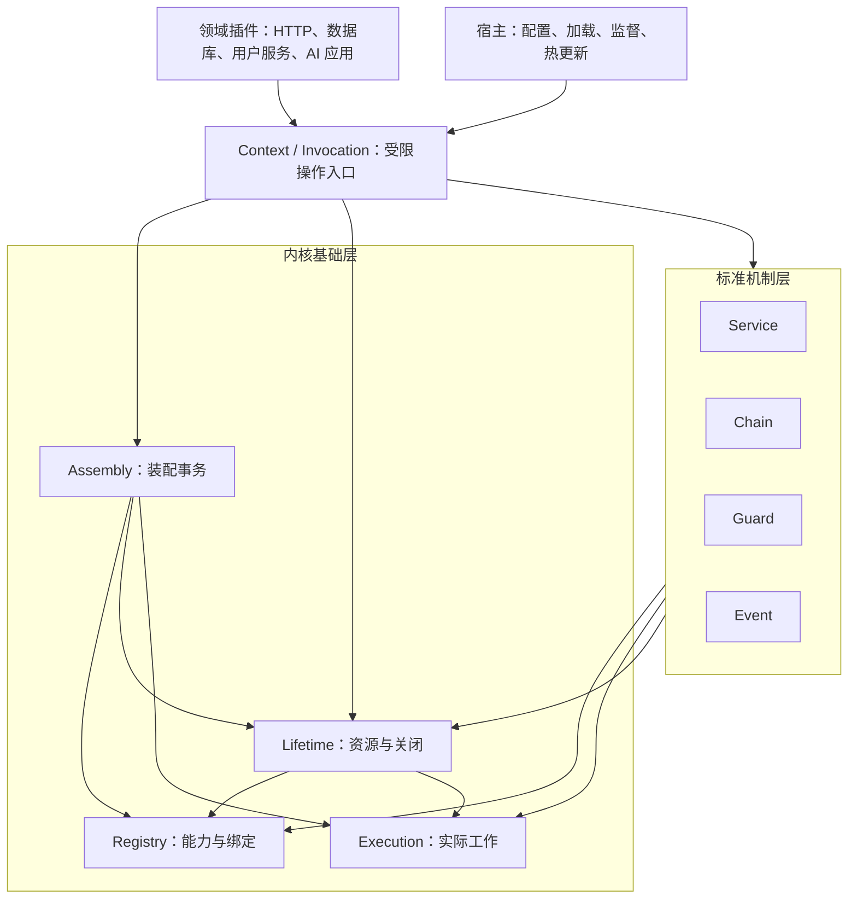

# 插件内核重构方案

状态：实施设计与验收边界记录。当前结构、公共接口和算法以 [架构](../ARCHITECTURE.md)、[实现](../IMPLEMENTATION.md)、[API](../API.md) 为准；实际通过项目与未测量项目见 [验收记录](../VERIFICATION.md)。本文的性能目标不能当成已经完成的测量。

作者体验补充：[面向插件作者的设计与成熟实现参考](plugin-authoring-research.md)。它补充官方源码对照、目标外部写法、resource/deps 的实质改进与类型验证。实施顺序以先确定作者任务、再完成内部状态重构为准；公共接口切换单独验收，不把内部模块整理当作作者体验已经改善。

## 实施结果与调整

四个状态工厂及作者接口已一起落地，旧目录和重复包装删除，所有调用者使用同一 setup 和映射声明。当前实现的精确结构以架构文档为准。

内部端口采用私有容器加冻结命令/查询对象；Kernel 是只读端口组合。记录仍在受限模块间共享，不实现全记录不透明句柄化，也没有额外引入通用 CloseOperation 元对象。关闭继续由同一 Owner/Scope Promise、固定期限和实际工作屏障协调。这一取舍减少授权和句柄协议，同时保留公开行为回归；不将容器封装夸大为所有记录写入已被静态证明。

三个固定种子模型、六项故障注入、默认 JIT 与引用隔离的一万轮轮换、真实 HTTP/SQLite 组合和工作区四门已运行。第 16 节的 60 分钟持续运行及比较延迟门槛尚未执行，仍是独立性能认证目标；不能把本次功能交付称作已经通过这些认证。详细数字、装置调整和边界见验收记录。

## 1. 最终推荐

本轮重构采用“薄 Context + 四个状态所有者 + 标准机制层”。优先降低状态和生命周期规则的分散程度，内部重构阶段保留现有对外行为与四种通用协作机制，不立即公开新的 Hook/Endpoint 元协议。作者接口切换由补充方案单独定义与验收。

四个状态所有者分别是 Registry、Execution、Lifetime、Assembly。Service、Chain、Guard、Event 是建立在它们之上的标准机制层。内核基础层不理解 next、allow/deny、事件载荷与监听队列；标准机制层不直接修改基础层账本。

这是一份可独立实施、验收和交付的完整重构方案。标准机制物理迁出为插件包是另一项有明确证明门槛的设计选择，不是本轮必须完成的条件。

判断“纯粹”的标准是：新增业务不修改内核，运行保障不允许绕过，每个事实只有一个权威所有者。原语数量、文件数、源码行数和包数量都不能单独衡量简洁性。

固定决策：

1. 保留显式 token、Result、Invocation 与受限 Context，不引入动态属性代理或开放内部状态事件拦截。
2. 保留固定依赖和 Provider 实例身份，不自动重定向旧门面，不因依赖出现自动重新执行插件。
3. 保留批次暂存、原子发布、失败回滚和未收敛装配阻断。
4. 保留公开回执与实际结束分离、唯一资源归属、清理依赖和失败账本。
5. 统一全部关闭路径，不能让手动 disposer 使用较弱的释放规则。
6. 先验证目标作者接口和失败语义，再完成内部结构重构；不同时调整清理接口、激活通知、预算语义和扩展错误来源。作者接口切换采用补充方案的独立里程碑。
7. 原地替换每个权威状态，旧实现同一步删除，不保留兼容别名或双轨字段。

## 2. 目标与边界

目标是一个可组合、可在线装配、可关闭、可诊断的通用进程内插件宿主。普通服务端应用、AI Agent 和其他应用都建立在其上。删除全部 AI 相关包后，core 必须仍能独立运行；公共契约、命名和默认行为不得依赖 AI 业务概念。

| 归属 | 内容 |
| --- | --- |
| 内核基础层 | 插件身份、定义、能力登记、固定绑定、可见性、资源归属、受管执行、装配和关闭 |
| 标准机制层 | 服务适配、调用链、决策聚合、内存事件通知及各自的组合规则 |
| 外部插件 | HTTP、数据库、缓存、定时任务、认证规则、业务服务、模型、工具、提示词、记忆、可靠消息、业务恢复 |
| 外部宿主 | 包获取、模块导入、配置、代码热更新、监督重启、进程隔离、强制终止与流量切换 |

基础诊断和状态快照留在内核；日志格式化、采样、输出和持久化外置。执行期限需要的可注入时钟留在基础层；定时任务、防抖、节流属于可选能力。

Scope 是可见性、生命周期和预算范围，不是安全沙箱。可信插件仍可直接使用 JavaScript 平台能力；内核只能保证经过受管接口的行为。

本轮不新增分布式协调、持久执行、自动重试或不中断热替换承诺。

## 3. 实测基线与当前证据

基线来自 2026-10-15 当前未提交工作区。历史审查中的故障不能直接当成当前未解决问题。

| 项目 | 本轮实测 |
| --- | --- |
| lint | 类型感知检查通过，零警告门禁；77 个生产文件通过源码边界检查 |
| typecheck | 通过；19 个类型负例拒绝，23 个文档片段通过 |
| build | 通过；75 个模块，浏览器目标 ESM，100.47 KB |
| test | 26 个文件，283/283 用例通过 |
| 语句覆盖率 | 90.41%，1717/1899 |
| 分支覆盖率 | 88.55%，1168/1319 |
| 函数覆盖率 | 96.09%，271/282 |
| 行覆盖率 | 96.31%，1333/1384 |
| 已配置阈值 | 语句 90、分支 88、函数 95、行 96 |

覆盖率输出到独立目录，没有覆盖工作区默认报告。以上是当前实现的基线，不是重构后的结果；本轮没有执行性能、长期轮换和跨进程验证。

取样源码摘要：SHA-256 `85c45a508bc9dc3d0a5b4429dfd847a36baee8bedeb5a2adbfbbc7007fccd8e7`。按路径排序读取 core/src 全部 TypeScript 文件及 package.json、vitest.config.ts、scripts/check-kernel.ts、scripts/check-types.ts，每项累加“相对路径、空字节、文件字节、空字节”。它记录取样状态，不代表共享工作区此后不会变化。实施前重新冻结基线并运行验证。

当前改进依据：

| 代码位置 | 结构问题 | 重构方向 |
| --- | --- | --- |
| core/src/runtime/types.ts | 完整 Runtime 暴露多领域 Map、Set、记录和计数 | 闭包私有状态、窄命令与只读快照 |
| core/src/tasks/start-work.ts | 登记和结算需要协调多份活动关系 | Execution 独占全部工作事实 |
| closeScope、unloadPlugin、rollbackInstall、close handle | 多条关闭编排路径 | 单一 CloseOperation |
| core/src/chains/collect-handlers.ts | 每层祖先重复扫描全体登记 | Provider+Scope 局部有序索引 |
| core/src/runtime/types.ts 的 Registration | 通用登记混有事件队列状态 | 调度状态归标准事件机制 |
| context 各工厂 | 同时承担权限、生命周期判断和具体调度 | 只装配受限操作门面 |

这些证据说明修改容易扩散，不等于本轮已经发现新的运行期 bug。

## 4. 多方案推演与取舍

| 路线 | 收益 | 代价 | 决策 |
| --- | --- | --- | --- |
| 四种公开机制不变，内部深化 | 保留已有行为、测试和调用方式，集中状态所有权 | 核心产品包仍带标准机制 | 本轮采用 |
| Service + Owned Hook，标准机制外置 | 组合算法与基础内核可独立使用 | 新增执行许可、计划权限、延迟投递和实际结束协议 | 独立候选，尚未通过运行证明 |
| 只保留 Service，加 Endpoint/Attachment/Execution | 所有组合可由服务表达 | 表面概念少，实际引入端点、附件和投递授权体系 | 不推荐本轮采用 |
| 任意 kind + 自定义执行器和生命周期钩子 | 灵活 | 第三方进入准入、提交与关闭关键路径 | 不采用 |

独立对抗检查发现，Owned Hook 草案存在以下不能靠移动目录解决的问题：

- 订阅者若拿到通用 capture/observe 能力，可以绕过事件发送权限。
- 绑定发出工作寿命的计划无法在 emitter 结束后继续安全投递事件。
- 仅使用 capture 时的父调用，会把多层 next 错接为兄弟工作。
- 外部包若只看到 outcome，无法等待实际结束来禁止事件和 next 重入。
- 清理期间开放处理器计划需要额外的执行者与依赖保留体系。

为解决这些问题直接公开更多低层协议，会增加新的状态空间。当前目标同时强调简洁和稳定，因此先收拢已有规则，比立即改变原语集合更有确定性。

从 Cordis 学习：安装定义与实例分离、统一资源归属、生命周期串行收敛、固定服务身份、消费者关系与外围包划分。

不照搬：Proxy 动态属性、原型访问来源推断、默认依赖响应式重载、开放内部状态事件修改关键行为、清理抛错后仅记录日志就解除所有依赖。

## 5. 目标架构



这是职责图。源码依赖和工厂注入规则见第 7 节，不能仅凭图没有环就宣称实现无循环。

基础层不认识事件名、next、allow/deny、消息角色、Agent 身份或工具种类。标准机制可以调用受管基础操作，但不能直接取出其他插件的原始函数在外部执行。

本轮四个模块和标准机制层仍属于一个内核包。目录分层已经有价值，不要求各自成为新包，也不承诺当前 Context 聚合入口能自动裁剪所有未使用机制。

## 6. 每个事实只有一个所有者

| 权威模块 | 独占事实 | 对外输出 |
| --- | --- | --- |
| Registry | 定义引用、Provider 槽位和代次、预留/发布/退休、固定绑定、门面租约、处理器登记和顺序 | 不透明能力句柄、固定计划、消费者查询快照 |
| Execution | 工作记录、首次结果、实际完成、父子关系、显式等待图、等待消费者、执行容量与 timer/signal | 工作句柄、结果与实际结束、局部 drain |
| Lifetime | Scope/Owner、资源、清理执行者、强清理依赖、关闭状态与 CloseOperation | 不透明生命周期句柄、关闭计划与剩余身份 |
| Assembly | manifest 快照、安装依赖规划、安装事务阶段、装配队列与未收敛装配 | 安装/卸载结果、事务身份与不可变计划 |
| Event 标准机制 | 监听队列、载荷快照、pending 数量、运行中监听、调度暂停与恢复 | 通知回执和事件统计 |
| Foundation | 单调时钟、宿主私有身份、Result、安全输入读取、有界诊断 | 值与受限基础操作 |

重要归属细则：

- Provider 是否可见、已退休或已释放，只由 Registry 决定。
- Resource 对 Provider/清理代码的强依赖只由 Lifetime 决定。Registry 可以维护可重建反向查询索引，不能有另一套权威 pins。
- Work 是否实际运行只由 Execution 决定。Lifetime 订阅或查询工作句柄，不自行维护另一份活动真值。
- Owner 是否接受新工作由 Lifetime 决定；安装事务阶段由 Assembly 决定，两者不是同一事实。
- Definition、Provider、Resource、Work 的容量分别由所属模块预留和释放；多项预留在一个同步段成功或回撤。
- 事件计数由事件机制独占；登记在 Registry 中的存活状态不可由队列反向决定。

各模块用函数闭包保存 Map/Set。不允许把 Runtime 拆成四个公开对象后，又向全部函数传递四对象全集。内部 Record 不通过公共入口导出。

## 7. 内部接口、源码依赖与主要时序

以下是内部接口边界草案，不是新增公开协议。所有 handle 都是不可伪造或经过宿主私有表验证的引用。

```ts
interface RegistryPort {
  reserve(plan: InstallPlan): Result<Reservation>;
  commit(reservation: Reservation): Result<void>;
  bind(query: BindingQuery): Result<BindingHandle>;
  capture(query: HandlerQuery): Result<HandlerPlan>;
  retire(targets: readonly CapabilityHandle[]): Result<void>;
  dependents(targets: readonly ProviderHandle[]): readonly OwnerHandle[];
}

interface ExecutionPort {
  start(spec: WorkSpec): Result<WorkHandle>;
  wait(spec: WaitSpec): Promise<AnyResult>;
  drain(selection: WorkSelection): Promise<DrainReport>;
}

interface LifetimePort {
  attach(spec: ResourceSpec): Result<Disposer>;
  requestStop(plan: ClosePlan): Result<CloseOperation>;
  converge(operation: CloseOperation): Promise<Result<CloseReport>>;
}
```

这些类型在实施前配套建立可编译的类型正负例。它们说明边界，不声称上述名称在当前代码中已经存在。函数数量不作为硬指标，避免用巨大命令联合伪装小接口。

源码规则：

1. contracts 和 foundation 不依赖标准机制、Context 或 Assembly。
2. Registry/Execution store 只依赖底层值类型和窄端口，不导入 Context 工厂，不互相取得完整 state。
3. Lifetime 协调器使用 Registry/Execution 窄操作；它不导入 services/chains/guards/events。
4. Assembly 使用三个模块的窄操作，不修改其内部记录。
5. 标准机制适配器组织调用，实际用户代码通过 Execution 进入。
6. 根装配处注入 Invocation/Cleanup 门面工厂等必要窄能力，不注入完整 Runtime。
7. 基础层的内部通知是有类型的单向事实通知，不是可被业务插件拦截的通用事件总线。

一次服务调用：

```text
门面验证 lease → 查询固定 Provider → 同步校验 Owner/Scope 准入
→ Execution 预留预算并登记工作 → 微任务进入实现
→ 生成 Result → 等结构化实际工作 → 结算与撤销引用
```

一次安装提交：

```text
Assembly 预检 → Registry 预留 → Lifetime 创建 staging Owner
→ Execution 受管激活 → Assembly 重检
→ 同步切换发布与准入 → 完成安装回执
```

安装预检与受管激活之间允许异步初始化；最后一次完整重检到注册发布和生命周期准入切换完成之间，不得 await 或执行业务回调。提交段失败必须在外部可见前整体回撤；停止屏障可以使最终重检失败。执行前再次验证取消和退休状态，防止预留后、真正进入前的状态变化。

跨模块同步转换由上层协调器调用窄操作完成；每个操作只能修改所属状态。禁止借反向 callback 隐藏任意跨模块写入。

## 8. 必须保持的公开行为

| 行为 | 保持内容 |
| --- | --- |
| token | 对象身份匹配，名称用于冲突检查；同名不能自动接线 |
| 依赖 | 安装时固定 requires/optional；缺席 optional 不自动补齐 |
| 门面 | 固定具体 Provider；提取方法仍有效绑定；撤销后不换代重定向 |
| 范围 | 本范围与祖先可见，兄弟不可见，shadow 明确；退休不静默回退 |
| 安装 | 全批次暂存，成功一次发布；同批激活可见 overlay，外部不见半批 |
| 回滚 | 先整批停止准入，再等实际激活与资源收敛；未收敛保持 degraded |
| 调用 | 来源、执行者、资源拥有者分开，bind 保留父子、取消、期限与权限 |
| 任务 | ctx.startTask 是拥有者级；call.spawn 是结构化子工作；显式等待检测环 |
| 回执 | 首次 timeout/cancelled 不被迟到成功覆盖；等待超时不取消目标 |
| 清理 | 固定清理依赖可以在 stopping 时使用；清理实际调用也必须排空 |
| 关闭 | 重复/并发共享 operation 和截止时间；超时不伪装实际完成 |
| Chain | 稳定计划、撤销检查、顺序 next、并发/迟到/未观察检查与真实排空 |
| Guard | 空集合失败，首次拒绝停止，全部允许才通过，异常不变允许 |
| Event | 有界原子入队、不可变快照、每监听者 FIFO、实际结束前不重入 |
| 引用 | 保存旧门面、disposer、任务和 continuation 不保留可释放的完整宿主 |

这些规则以当前 API 和通过的回归为依据。若规范与实际测试存在未发现的不一致，先记录明确的契约差异并独立处理，不在重构中静默改变。

## 9. 生命周期与唯一关闭协议

插件执行失败、关闭操作失败、公开等待超时是三个不同事实，不能共用一个含义模糊的 failed 字段。

```text
Owner: staging → active → stopping → stopped
          └────────────→ stopping

CloseOperation.actual: stopping → draining → releasing → closed | failed
CloseOperation.receipt: pending → succeeded | incomplete | failed

Provider: reserved → configured → published → retiring → released
Resource: attached → releasing → released | failed
Work.actual: running → settled
Work.outcome: pending → first-success | first-failure
Install: planned → staging → committed
                       └→ rolling-back → rolled-back | unsettled
```

状态转换由权威模块的单一动作维护。现有公开状态字段由这些事实生成，初期不改用户看到的状态词。移除重复推断事实的自由 boolean 组合。

dispose、closeScope、unload、rollback、手动 disposer 共用 CloseOperation：

1. 入口选择目标与检查权限，计算 scope 子树或级联闭包；默认发现外部消费者即拒绝。
2. 固定唯一 deadline，建立操作身份及局部统计。
3. 在首个 await 前整体停止业务准入、退休能力、撤销业务门面、清除未进入通知并发取消。
4. 等待 executor 或 resourceOwner 受影响的实际工作，包括迟到初始化与子工作。
5. 先处理消费方资源，再释放其依赖的提供者。子范围、创建关系和清理依赖纳入关闭计划，不能靠 Map 插入顺序代替。
6. 清理使用独立信号、固定期限和受限依赖；其嵌套实际工作继续进入局部排空集合。
7. 循环排空新出现的受管清理工作，直至真正收敛。
8. 失败资源保留依赖，继续处理不受其阻塞的其他资源。
9. 全部实际结束后释放能力、定义、租约、Context cell、timer、signal 监听和索引，才标记 closed。

公开期限到达先返回 close-incomplete，actual 可以继续。历史回执不改写；inspect 可以反映后来真正完成的状态。

手动撤销在许可检查后同步进入 retiring，再异步释放；槽位仍占用到真实释放。重复调用共享回执，没有隐式重试。资源统计来自操作实际释放的身份，不使用根总量相减。

## 10. 依赖、清理与保留规则

必须区分四类关系：

| 关系 | 权威位置 | 意义 |
| --- | --- | --- |
| 固定安装依赖 | Registry 绑定，Assembly 规划 | 安装排序与默认卸载保护 |
| 处理器登记索引 | Registry | 能找到谁，可同步撤销，不自动产生永久反向依赖 |
| 资源清理保留 | Lifetime | 清理执行代码和所需 Provider 仍必须可用 |
| 工作等待 | Execution | 工作实际连接与显式等待环 |

监听者依赖事件提供者，而事件提供者能索引监听者，不因此构成安装环。

资源拥有者和清理执行者可能不同。例如 A 消费 B 创建的订阅：资源属于 A，清理代码由 B 提供，必要依赖来自 B 的固定依赖。

本轮采用明确的保守规则：一个 Provider 仍被必要清理引用时，保留它的实现及提供该服务所依赖的 Owner 资源；不宣称能够自动识别实现背后哪些连接是“无关资源”。同一 Owner 内先清理消费方资源，再撤销提供者登记。跨 Owner 由实际依赖与资源归属协调；现有保护回归必须保持。

区分外部资源对 Provider 的保留和 Owner 自有资源清理。自有 pin 不能被解释为永久阻止自身清理。M0 明确自有 pin、外部 pin、清理失败 pin 的转移表；M3 逐项验证自有清理能够进入、外部清理完成前提供者仍可用、失败依赖不被提前释放。

不把全部关系折叠成 Owner DAG，也不引入尚未证明的全新 resource-cycle 拒绝策略。先用现有行为矩阵验证资源顺序和失败保留；遇到真实环或无法收敛，返回明确未完成并保留身份，不能删除依赖制造成功。

保留资源登记在分配外部资源之前的要求。内部实现可以先保存空句柄，受管 open 后再赋值；作者通过补充方案的 resource 操作完成配对，不手写此协议。实际 open 未结束前不能提前移除登记。登记失败不得留下半份索引或容量。

空句柄本身不是完整保证：资源创建工作必须受管且与该资源的释放屏障关联，清理先等实际 open 结束，再释放成功取得的句柄。取消、失败和迟到成功都必须结算。手动 disposer 与 open 并发也遵循相同屏障，不能先因句柄为空报告释放成功；涉及等待自身创建工作的请求，按现有适用失败契约拒绝自等待并保留账本。此场景进入 M0 行为核对和 M3 专项回归，不依赖调用者偶然没有并发。

清理中的 call.bind/use 必须传递 cleanup phase、deadline 和资源归属。现有合法清理 chain/guard 路径继续受管，不能因为重构限制当前已承诺的能力。清理不通过受管入口新增后台任务、资源或范围。

如未来决定把清理限定为固定服务调用，应作为单独的公开契约修改提出，不夹带到内部结构重构里。

## 11. 标准机制层怎样保持纯粹

标准机制层通过内部能力句柄和执行端口工作，不能取得整个 Runtime。

| 标准机制 | 自己负责 | 基础层负责 |
| --- | --- | --- |
| Service | 方法适配、可选输入/输出/失败校验 | 固定绑定、租约、准入与受管执行 |
| Chain | next、短路、重试顺序、Continuation 观察 | 有序登记、稳定身份计划、父子执行与真实完成 |
| Guard | allow/deny 聚合和无配置失败 | 登记、计划、取消、期限与工作归属 |
| Event | 载荷快照、队列、FIFO、暂停和容量恢复 | 登记可见性、实际监听执行、撤销和生命周期 |

处理器登记只保存通用身份和顺序，不再为 chain/guard 分配 queue/running 字段。事件机制用 Registration handle 管理自己的调度记录；核心登记仍是存活与发布的唯一权威来源。

执行接口区分同步子调用与独立监听工作：

- Chain/Guard 的 executor 为实际处理器注册者，resourceOwner 继承逻辑消费方。
- 每次 next 的下一项与终结服务都挂到当前处理器工作，不能挂回最初分发工作而成为兄弟。
- Event 的 executor 与 resourceOwner 都归监听者；emitter 是事件来源，不是监听工作的结构化父项。
- next 的并发锁与监听者串行锁等实际结束后才释放，不能仅等待公开 timeout 回执。

内部执行适配器可以把注册者自己的回调包装成受管函数，以便检测用户函数返回时的 unfinished-next。禁止的是取出其他注册者裸函数绕过 Execution；不禁止一个受管函数调用自己的内部业务函数。

事件执行容量暂时不足时的排队和恢复机制必须有取消与期限，不能无界忙轮询。保持现有已验收行为，补充无关工作释放容量后通知可继续的定向测试。

本轮不改变事件激活可见性、发送权限、错误来源或公共统计字段。标准机制层不是领域业务，保留它们不会让内核懂 Agent。

## 12. 索引、容量与热插拔

Registry 建立：

- token/name 身份索引与 reference→definitions 反向索引。
- Scope→Provider 槽位，包含预留与退休占用。
- Provider→固定消费者的反向邻接表。
- Provider+Scope→有序处理器登记；捕获沿范围祖先取得匹配项。
- Provider/Owner/Work 相关 lease 的局部撤销索引。

反向索引是权威关系的投影，在同一动作中更新。用局部一致性断言和公开回归校验，不通过后台修补掩盖不一致。

目标复杂度：装配规划接近节点与边数量；服务解析与范围深度相关；处理器捕获与范围深度和匹配数相关；卸载闭包与涉及的依赖边相关。每次普通调用不扫描完整宿主。

本轮保持既有预算契约与配置字段，不在同一个迁移中改成新计数语义。容量预留和实际释放归权威模块，staging、retiring、失败保留及实际未结束工作不能凭公开失败回执释放额度。

另行讨论的预算改进包括：根全局额度与子范围局部额度的区分、executor/resourceOwner 跨范围去重规则、独立有界清理额度。只有规范、类型、边界测试和调用者同步更新后才实施；不能直接把全局计数与局部额度混用而声称已完成隔离。

默认热替换仍由宿主停止受影响消费者、排空清理、卸载旧提供者、安装新提供者并重新装配消费者。旧门面不重定向。

根装配队列保留，停止请求不排在它后面。root 是一个装配故障域；独立可用性要求独立 root/Worker。本轮不同时引入分区装配或自动依赖重启。

## 13. 目录迁移与删除清单

```text
core/src/
  contracts/
  foundation/
  registry/
  execution/
  lifetime/
  assembly/
  mechanisms/
    services/
    chains/
    guards/
    events/
  context/
  index.ts
```

| 当前代码簇 | 目标 | 同步删除 |
| --- | --- | --- |
| runtime 中定义/租约与 services 绑定提供、plugins 预留发布 | registry | Runtime 中被替代字段及跨模块直接写路径 |
| tasks 与散落调用登记、等待和 timer 解除 | execution | 旧 works/counters/waiting 权威字段 |
| scopes、effects、各类 close | lifetime | 重复关闭编排与 Owner 内部直接修改 |
| plugins 中 manifest、规划、事务队列 | assembly | 对注册/资源/工作记录的直接修改 |
| services/chains/guards/events 的组合算法 | mechanisms | 旧位置实现和私有路径别名 |
| context 工厂 | context | 全局依赖扫描和具体关闭调度逻辑 |
| 故障、安全读取、signal、scheduler | contracts/foundation | 功能相同的重复实现 |

一动作一文件，不为了目录对称新增透传层。上述目录是责任目标，不要求机械复制当前文件名或保持文件数量。

公共 index 保留一套正式入口。内部文件迁移不产生旧路径转发；生产和测试导入一次调整。其他包不能使用 core 私有路径。

## 14. 实施里程碑

### M0：规格、基线与行为映射

同时完成作者体验补充中的 DX0：类型化依赖一次声明、请求绑定依赖、完整资源操作与典型插件任务。目标写法必须先证明可推断、可校验，不能最后再给内部实现包一层外观。

确认当前共享改动归属，记录需要的未提交基线；在合适的隔离 worktree 实施，不把他人变更作为自己提交。不使用 stash 或销毁性 Git 操作。

交付源码摘要、四门输出、coverage JSON、公开行为矩阵、接口调用清单、测试去向表、性能基线脚本与可编译内部端口草案。

退出：现有红测如实归属；当前行为与规范差异列明；不依赖陈旧文档计数。

### M1：Registry 独占能力状态

统一 reserve/stage/commit/bind/retire/close，建立局部登记和消费者索引。每迁移一个事实，删除旧 Runtime 字段和所有写路径。

退出：身份、optional、shadow、原子发布、撤销同 tick、定义回收回归通过；没有新旧注册表同步逻辑。

### M2：Execution 独占工作状态

集中准入、第一次结果、actual、父子、显式等待、等待订阅、容量和引用释放。所有标准机制使用窄执行端口。

退出：公开超时不释放实际活动；父工作实际排空；等待订阅回收；嵌套身份、取消、期限和工作图通过；删除旧工作账本。

### M3：Lifetime 与统一关闭屏障

集中范围/Owner、资源和强清理依赖，统一所有关闭入口和操作统计。保留当前清理能力与保守依赖保护。

退出：失败资源保留依赖；其他可释放资源继续；并发关闭和重复撤销不延长预算；迟到工作继续追踪；统计不受无关并发影响。

### M4：Assembly、标准机制与薄 Context

装配只拥有规划和事务，标准机制只拥有各自算法和调度状态，Context 只组合受限能力。删除可写全局 Runtime 账本的跨模块传播，协调对象只组合状态端口。

退出：权威容器通过各自端口修改；内部记录的跨模块操作遵循已明确的协作流程；标准层使用受管执行调用处理器；源码 DAG 与运行时行为检查通过。不声称静态检查覆盖全部记录写入。

### M5：故障、性能与生产边界验收

对外宣称简化完成之前，必须完成作者体验补充中的 DX1 和真实全旅程。内部 M1—M4 可以保持当前接口完成重构；definePlugin/deps/resource 等作者入口只在实现、调用者、规范和测试同一迁移完成后成为正式 API。

执行第 15—17 节的适用测试、GC、轮换压力、定向应用组合和独立对抗审查。更新 API、ARCHITECTURE、IMPLEMENTATION、README 与 VERIFICATION，使其准确描述实现和实际数字。

退出：没有已知未解决的安全、泄漏或正确性问题；达到当前行为与门禁；未运行项目如实注明，不宣称尚未完成的高可用验证。

这些里程碑构成完整交付，不以未来标准包外置为完成条件。紧耦合状态迁移可以合并为一个原子里程碑，不能为凑小提交保留双轨。

每步运行模块测试与工作区四门；只点名提交自己的文件，不 push、不 publish。

## 15. 测试与覆盖率计划

现有用例已经大量通过公共入口验证行为，应保留有效断言。测试位置仍为各模块同目录 __test__；跨包不导入别人的私有测试辅助文件。

建立可追溯表：旧用例与关键断言、目标位置、验证的规则、迁移原因、运行结果。不能只对比用例总数。

| 类别 | 必须保持或新增的验证 |
| --- | --- |
| 身份与输入 | 同名异 token、伪造对象、跨 root、旧代次、getter/Proxy 抛错、非法配置 |
| 依赖与范围 | optional 固定、祖先解析、兄弟隔离、shadow、退休不回退、子范围不扩权 |
| 安装事务 | 暂存登记不可见、失败回滚、子范围事务传播、激活取消、提交与关闭同 tick |
| 生命周期 | 迟到资源、手动撤销准入屏障、固定 deadline、重复关闭、失败保留和独立统计 |
| 工作 | outcome/actual 分离、迟到成功不改回执、父子真实连接、显式等待环、等待订阅回收 |
| 调用归属 | origin/executor/resourceOwner，处理器自身固定依赖、cleanup 嵌套调用 |
| Chain | 顺序 retry、未实际结束不并发、late/unfinished/unobserved、派生分支持续排空 |
| Guard | 空集合失败、全 allow、首次 deny、异常取消超时不变 allow |
| Event | 原子容量预留、FIFO、超时未结束不重入、监听者/提供者撤销、容量恢复与排队引用释放 |
| 清理 | stopping 依赖可用、清理内实际工作被等待、失败 pins 保留、相关和无关资源顺序 |
| 诊断 | sink 抛错与重入、坏时钟、工作身份、有界摘要、不保留业务对象图 |
| 引用 | 保留旧门面、disposer、wait、TaskHandle、Continuation 后宿主可回收 |

竞态使用 deferred、可推进单调 Scheduler 和显式微任务刷新，不依赖长时间 sleep。GC 用独立子进程和硬期限。所有可控工作最终明确结算。

增加固定随机种子模型测试：load/use/on/dispatch/emit/spawn/cancel/unload/close，验证无越权、无超量、无重复释放、closed 无存活账本、旧代次不复活。

定向反向验证最少破坏五项：发布门、代次检查、actual 等待、清理 pin、范围过滤。对应断言必须真实失败，恢复后运行完整门禁。

保持现有覆盖率阈值，按同统计口径不得低于实施前实测；代码迁移不得移出 coverage include。报告语句、分支、函数、行的分子分母与百分比。覆盖率上升不能代替行为矩阵。

```sh
bun run lint
bun run typecheck
bun run build
bun run test
```

typecheck 继续包含真实公开入口正例、错误使用负例和文档示例。build 继续验证纯内核构建。只运行改动相关应用旅程，不直接执行根 e2e main.ts。

## 16. 性能与长期容量验收

先建同机器、同 Bun、同输入和调度策略的基线，记录硬件、预热、样本数、重复轮数和 GC 条件。以下是拟定验收标准，不是本轮已经完成的数字。

| 测量 | 场景 | 目标 |
| --- | --- | --- |
| 服务调用 | 空实现、小对象、单层与嵌套、冷热门面 | 吞吐、分配、median/p95/p99 不发生不可接受退化 |
| 处理器捕获 | 固定匹配数，增加无关登记，范围深度 1/8/32 | 成本随深度与匹配项变化，不随无关登记全局扫描 |
| 装配和卸载 | 100/1000 插件，链形与扇形依赖 | 以局部邻接索引求闭包，不反复 owners×effects 全局扫描 |
| 事件压力 | 慢监听、超时、容量边界、定期撤销 | 有界、不重入、其他监听者继续、容量可恢复 |
| 轮换 | 1000 与 10000 轮安装/卸载 | 正常轮次账本回零，GC 后保留对象不随轮数增长 |
| 持续运行 | 至少一轮 60 分钟，定期取消、超时、受控失败与热插拔 | 无未处理拒绝、容量失真或不可解释的持续保留增长 |

服务常见路径 median 退化超过 10% 或 p99 超过 15%，且超出多轮噪声区间时，不得宣布该性能验收完成。需要接受不同 SLO 取舍时，先明确更新方案与用户目标，不能仅写一句“可以解释”。

不承诺重构必然加速；间接层和句柄可能增加分配，必须实测。包体大小作为观测，不以削弱实际执行追踪换取更小数字。

## 17. 高可用与故障域

内核保证失败可见、停止新增、资源有归属、剩余工作身份真实、有界诊断与可等待关闭。自动恢复、进程监督和业务恢复由外部负责。

| 故障 | 内核行为 | 宿主行为 |
| --- | --- | --- |
| 回调抛错或非法结果 | Result 失败，记录诊断，继续维护账本 | 按业务策略决定重试或停止 |
| 调用超时但实际仍运行 | 固定第一次失败，保留实际工作 | 等待、取消相关实例或终止外部 Worker |
| 清理失败 | 保留资源和依赖，返回真实失败 | 诊断、告警、人工或进程级处置 |
| 回滚未收敛 | root degraded，拒绝新增装配 | 隔离受影响 root/Worker |
| 进程崩溃或同步死循环 | 进程内机制无法继续执行 | 外部监督、重启与持久状态恢复 |

不中断替换需要独立 root/Worker、健康检查、流量切换、排空与状态迁移协议，不通过偷偷重定向旧门面实现。

不在本轮新增无限重试、自动重跑 setup、强制清空失败账本或 root 内分区装配，以免同时扩大故障状态空间。

## 18. 标准扩展物理外置的独立决策门槛

若后续仍要求“核心包只包含 Service/Hook”，必须另立接口设计与运行证明，不能直接执行先前未闭合的草案。

证明必须同时解决：

1. 登记权与执行权分开，事件订阅者不能绕过 provider-only 发送限制。
2. 同步计划只在授权调用树内有效；每次 next 和 terminal 显式绑定当前父 Invocation。
3. 异步投递授权不依赖 emitter Work，能延迟启动，Provider/Registration 退休可取消，不强持 emitter Context。
4. outcome 与 settled 的窄公开协议足够支撑事件 FIFO 和 next 防并发。
5. staging 登记统一发布、回滚与容量；不能用外部总线 Map 代替核心发布事实。
6. 清理执行者及其固定依赖在真实释放前保留；明确是否改变 cleanup.dispatch。
7. 每 root 事件运行实例和总容量不可通过重复实例或子范围绕过。
8. 只有公开入口，无 Runtime、Owner、Work 或自填 executor 旁路。

至少提供三条完整运行旅程：两个中间件加顺序 next 重试；延迟事件投递加容量恢复和撤销；Guard 首次拒绝。仅类型草案不足以证明。

评估总复杂度时，统计新增授权、投递票据、附件、状态机和测试成本，不只看 core 少了几个目录。若为外置持续增加专属底层协议，保留标准机制层是更合适的结果。

通过证明后，物理外置、清理/激活阶段契约、预算语义分别形成独立的原子迁移；每项都同步改规范、调用者与测试并删除旧入口，不保留双轨。本轮不预先改变它们。

## 19. 风险与最终收口

| 风险 | 控制措施 |
| --- | --- |
| Runtime 只是改名拆对象 | 每事实权威表、私有闭包、跨模块写入检查、实际运行时协作审查 |
| 关闭统一后规则丢失 | 逐条映射当前回归，所有入口共用操作，但保留目标选择差异 |
| 索引增加导致事实重复 | 权威关系与派生索引分别命名，同步更新，局部一致性验证 |
| 为简洁删除真实追踪 | outcome、actual、资源释放分别验证，故障注入检验断言 |
| 多人共享文件被覆盖 | 冻结基线、隔离 worktree、只提交自己的点名路径 |
| 目录迁移假绿 | 不删有效断言、不缩 coverage 范围、不降低阈值、真实类型负例 |
| 追求自动恢复重复副作用 | 固定绑定、宿主显式重新装配，业务恢复协议外置 |
| 标准包外置演变元框架 | 独立证明门槛，不作为本轮交付条件 |

最终交付要求：公共行为符合当前规范；每个状态有唯一所有者；没有全能 Runtime；所有受管调用与清理可追踪；标准机制不含领域规则；四门、类型、GC、反向验证和适用压力证据齐全；文档只报告实际运行和已实现行为。

内部状态和作者接口已一起迁移。实现使用私有容器端口，但内部记录仍是受限模块共享的可变对象；不能声称已经实现全部记录的不透明句柄化或由静态规则证明全部写入所有权。长期压力与延迟 SLO 分别报告，四门通过不能替代未运行的认证。
