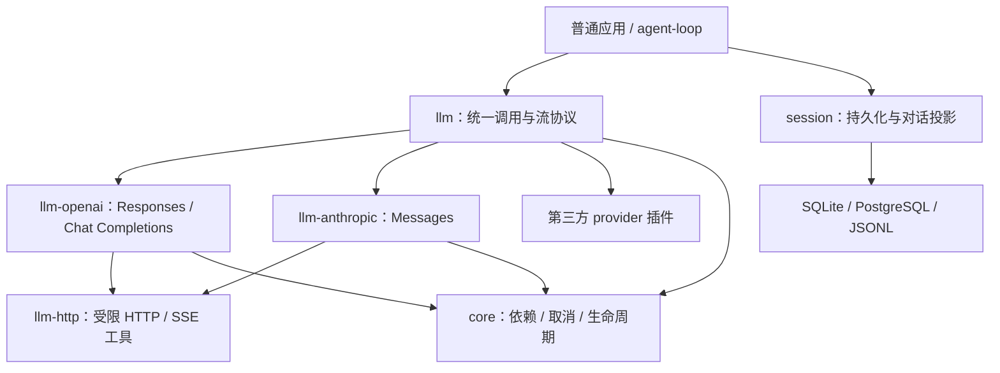

# LLM 设计基线

状态：已核销。级别：大，新子系统。工作流：feature-dev-v2；采用设计基线、施工图、验证口径三件套，并审计已有行为。2026-10-17。

## 1. 已确定的范围

用户裁决：参考现有实现及测试来发现需求，重新设计，不复制实现、不保留兼容入口；交付生产可用插件，重点是准确完整的流消息类型、稳定性、性能及外部作者易用性。

用户裁决：首批实际支持 OpenAI Responses、OpenAI Chat Completions、Anthropic Messages 三种协议。支持文本、图片输入、推理、客户端工具调用、结构化输出和引用。音视频及图片生成由独立能力扩展，不在本次首批实现范围内。

生产可用指契约、资源、异常、过载、测试及运维边界有明确证据；不以测试数量证明性能最优，不将外部模型服务可用性视为本插件能够保证的事实。

## 2. 包与依赖



llm/contracts 定义请求、流事件、完成结果和错误；llm/provider 定义提供者服务与公共状态校验工具；llm/testing 提供公共提供者检查器。源码及构建入口共享同一 token 身份。协议插件只依赖这些公开入口，不导入私有实现或其他包的测试。

llm-http 是共享实现库，不再注册一个转发服务；用于三个协议相同的传输预算、SSE拆帧及关闭算法。业务协议解码留在各适配器。llm 不依赖 fetch、文件系统、数据库或厂商 SDK；内核只提供通用的受管调用、取消和生命周期机制。

模型请求类型由 llm 自己定义，不引用 SessionMessage、SessionId 或工具运行时类型。agent-loop 负责读取session、构造模型输入、保存模型输出及决定何时执行工具。Session已有JSON metadata可保存模型来源、签名和引用；具体编码器在agent-loop阶段实现，不能以丢失不认识的块来完成转换。

## 3. 对外调用与生命周期

主服务：

```ts
interface LlmService {
  stream(input: LlmStreamInput): Promise<LlmResult<LlmSummary>>;
  generate(input: LlmRequest): Promise<LlmResult<LlmResponse>>;
  describe(input: ModelReference): Promise<LlmResult<ModelDescription>>;
}

interface LlmStreamInput extends LlmRequest {
  readonly onEvent: (event: LlmEvent, signal: AbortSignal) => void | Promise<void>;
}
```

stream 一直执行到提供者与消费者实际结束，不能取得一个裸AsyncIterable便结束受管调用。每个onEvent都等待结算，下一次读取按背压推进；消费者不需要处理的事件可直接返回。generate使用同一流状态机和有界累积器生成完整输出，不另写非流式网络路径。describe只返回已配置的模型能力及已知限额，不默认访问网络，不猜测上下文窗口。

另外提供 streamLlm(service, request) 作者辅助函数，返回单消费者AsyncIterable，并带readonly result: Promise<LlmResult<LlmSummary>>以保留包括CoreFault在内的原始服务回执。先消费事件再await result；只要完整响应应直接用generate。辅助对象第一次next才启动请求，单独创建或读取尚未开始的result不会发网络；预先signal取消可直接结算result。辅助函数最多保留1个待消费事件，底层只调用一次stream；break、return及调用方signal发出取消。辅助函数不建立新的模型运行时，不复制协议处理或再开后台永久任务。服务回执先失败而没有error事件时，辅助通道结束，result保留该失败，不捏造领域错误来替换CoreFault。正常消费结束也必须检查result；不在同一失败通道无限补发终态。调用返回的取消/超时Result仍遵守core首次回执语义，不能当作底层实际已经结束；宿主通过排空和inspect核对实际工作。

请求的signal和timeoutMs为调用方额外约束，最终与call.signal及call.deadline取交集，不能延长父期限。通过call.signal接收内核期限，不拿自有Date.now/performance.now与未知scheduler时钟域的绝对deadline相减。普通服务默认受core.callTimeoutMs约束，生产组合示例必须显式配置足够长的宿主期限；llm不偷偷修改内核上限。推理需要更长时间时由宿主或调用链显式给预算。

onEvent为显式回传通道，不使用通知Event充当token传输。它是受信任应用回调，异常归为consumer-failed。回调可能使用自身仍存活的call.deps；不授予提供者额外服务权限。不合作且永久不结束的回调不能在进程内强制杀死，仍计实际工作与容量，关闭报告未排空；外部进程监督归宿主。

## 4. 请求模型

LlmRequest包含provider、model、messages、tools、providerTools、toolChoice、output、reasoning、temperature、topP、maxOutputTokens、stop、providerOptions及可选signal/timeoutMs。仅provider/model/messages为必需，provider也可使用工厂中显式配置的defaultProvider；不根据当前注册数量猜默认提供者。

messages按角色作判别联合：system/developer/user/assistant/tool。图片source显式区分URL和base64，声明mediaType；不将路径字符串猜成图片，不代调用者读取文件或拉取URL。tool消息必须含对应callId；assistant工具调用使用已解析JSON对象。客户端工具定义只包括name、description、inputSchema及strict等声明，不携带执行函数。LLM不执行客户端工具。

引用输入补齐document及search-result块：document含调用方唯一sourceId、title、显式text/PDF-base64/URL/file-id来源及citations开关；search-result含sourceId、title、source URL、文本分块及citations开关，只允许协议支持的user/tool角色。提供者将输入sourceId与原生document索引建立有界映射，输出引用指回同一sourceId。不会自动上传文件或拉取文档；不支持的来源形式明确拒绝。Responses通过显式providerTools启用受支持的web_search/file_search声明以产生原生引用；file_search仅引用宿主已经准备的vector store ID，不在LLM内创建或维护索引。Chat只有协议/模型能力明确声明时接受相应引用能力。原生服务端工具的声明、进度与结果和客户端tool-call分开，不能交给tool-orch误执行。Anthropic citations与json-schema输出的互斥组合在发请求前返回unsupported-feature，不在网络400后才猜测原因。

输入校验包括角色允许的内容、重复callId、工具结果与先前调用配对、JSON深度及大小；不自动剥除或伪造消息来通过厂商校验。合法但厂商不支持的模态、developer角色、工具选择或严格结构化输出返回unsupported-feature，不静默降级为文本或普通JSON。

output为text、json或json-schema判别联合；json-schema含name、schema和strict。结构化输出在生成过程中仍是文本增量，不把半截JSON当成最终对象。stream和generate在同一个运行路径、公开finish之前完成JSON解析及所请求的schema校验；所需文本使用共享有界累积器，generate不再重复解析或验证。纯文本stream无需保留完整正文。格式不匹配与截断分开：格式不匹配返回invalid-output，拒绝、过滤及明确截断保留结束原因，不伪造一个符合schema的空对象。schema支持范围与厂商能力显式校验，未实现的JSON Schema关键字拒绝，不假装已验证。首批本地验证使用Ajv的受限schema入口：type（含nullable）、properties、required、additionalProperties布尔值、items、enum、const、min/maxLength、min/maxItems、minimum/maximum、description/title；禁止任意正则、format、uniqueItems、组合分支、$ref/递归/远端解析及自定义关键字。schema最多64KiB、深度16、2048节点，每enum最多128项，enum/const仅标量。严格校验、不强制类型转换、不补默认、不删除属性、首错退出；编译结果的缓存最多32项/4MiB，按精确schema身份复用，逐出及关闭清空。超出子集明确unsupported-feature，不假称支持全部JSON Schema；后续扩大子集必须补复杂度证据。

reasoning含明确的effort、budgetTokens及展示意图；不同提供者允许的组合按能力校验，不硬编码所有模型都支持同一套等级。providerOptions为按协议校验的JSON对象；保留字段不能覆盖model、stream、messages、工具、安全预算、凭据或目标地址。

## 5. 内容身份与流事件

流事件为封闭判别联合，每个事件带同一次本地requestId及从0递增的sequence。上游responseId/requestId/model在response-info中报告，本地ID和上游ID不混用。块ID在一次请求中唯一；一个块start一次、end一次，delta只能出现在中间，不复用上游不同维度的index充当全局ID。

事件词表：LlmResult复用core.Result，JsonValue复用core JSON类型；协议事件没有JS对象、异常、响应句柄或SDK私有实例。

```ts
type LlmEvent = LlmEventBody & {
  readonly requestId: string;
  readonly sequence: number;
};

type LlmBlockStart =
  | { readonly kind: "text"; readonly id: string }
  | { readonly kind: "refusal"; readonly id: string }
  | {
      readonly kind: "reasoning";
      readonly id: string;
      readonly visibility: "text" | "summary" | "hidden";
    }
  | { readonly kind: "tool-call"; readonly id: string }
  | { readonly kind: "provider"; readonly id: string; readonly providerType: string };

type LlmEventBody =
  | { readonly type: "start"; readonly provider: string; readonly model: string }
  | { readonly type: "response-info"; readonly info: ResponseInfo }
  | { readonly type: "block-start"; readonly block: LlmBlockStart }
  | { readonly type: "text-delta"; readonly id: string; readonly delta: string }
  | { readonly type: "refusal-delta"; readonly id: string; readonly delta: string }
  | { readonly type: "reasoning-delta"; readonly id: string; readonly delta: string }
  | { readonly type: "signature-delta"; readonly id: string; readonly delta: string }
  | {
      readonly type: "tool-call-delta";
      readonly id: string;
      readonly field: "callId" | "name" | "input";
      readonly delta: string;
    }
  | { readonly type: "tool-call"; readonly id: string; readonly call: LlmToolCall }
  | { readonly type: "continuation"; readonly id: string; readonly value: ProviderContinuation }
  | { readonly type: "citation"; readonly id: string; readonly citation: LlmCitation }
  | {
      readonly type: "provider-event";
      readonly scope: "request";
      readonly name: string;
      readonly data: JsonValue;
    }
  | {
      readonly type: "provider-event";
      readonly scope: "block";
      readonly id: string;
      readonly name: string;
      readonly data: JsonValue;
    }
  | { readonly type: "block-end"; readonly id: string; readonly status: "complete" | "incomplete" }
  | { readonly type: "usage"; readonly usage: LlmUsage }
  | { readonly type: "finish"; readonly summary: LlmSummary }
  | { readonly type: "error"; readonly error: LlmError };

interface LlmToolCall {
  readonly callId: string;
  readonly name: string;
  readonly input:
    | { readonly ok: true; readonly value: Readonly<Record<string, JsonValue>> }
    | {
        readonly ok: false;
        readonly reason: "invalid-json" | "not-object" | "incomplete";
        readonly raw: string;
      };
}

interface ProviderContinuation {
  readonly provider: string;
  readonly protocol: string;
  readonly model: string;
  readonly data: JsonValue;
}

type FinishReason =
  | { readonly kind: "stop"; readonly stopSequence?: string }
  | { readonly kind: "tool-calls" }
  | { readonly kind: "length"; readonly limit: "output" | "context" | "unknown" }
  | { readonly kind: "refusal" }
  | { readonly kind: "content-filter" }
  | { readonly kind: "pause" }
  | { readonly kind: "other"; readonly raw: string };

interface ResponseInfo {
  readonly protocol: string;
  readonly responseId?: string;
  readonly requestId?: string;
  readonly model?: string;
  readonly createdAt?: number;
}

type LlmCitation =
  | {
      readonly kind: "url";
      readonly url: string;
      readonly title?: string;
      readonly position?: CitationPosition;
    }
  | {
      readonly kind: "document";
      readonly sourceId: string;
      readonly title?: string;
      readonly citedText?: string;
      readonly position: CitationPosition;
    }
  | {
      readonly kind: "file";
      readonly provider: string;
      readonly protocol: string;
      readonly fileId: string;
      readonly filename?: string;
      readonly position?: CitationPosition;
    };

type CitationPosition =
  | {
      readonly kind: "range";
      readonly start: number;
      readonly end: number;
      readonly unit: "codepoint" | "utf16" | "utf8" | "page" | "content-block";
      readonly base: 0 | 1;
    }
  | { readonly kind: "provider"; readonly format: string; readonly value: JsonValue };

interface LlmSummary {
  readonly provider: string;
  readonly model: string;
  readonly response: ResponseInfo;
  readonly reason: FinishReason;
  readonly rawReason?: string;
  readonly usage: LlmUsage;
  readonly blocks: number;
  readonly hasOutput: boolean;
}

interface LlmUsage {
  readonly inputTokens?: number;
  readonly outputTokens?: number;
  readonly totalTokens?: number;
  readonly cacheReadTokens?: number;
  readonly cacheWriteTokens?: number;
  readonly reasoningTokens?: number;
  readonly complete: boolean;
}
```

文本与推理多个块按ID归属，允许不同块交错。tool-call完成值在其block-end之前发布；citation与完整continuation允许在对应块已结束、请求尚未终态时补充一次或多条各自独立引用，不允许因此继续文本/参数delta。provider-event显式区分请求级和块级，块级必须引用已存在的块，不能把ID隐藏在任意JSON中绕过状态校验。reasoning.text与summary区分；隐藏推理不合成可见占位文案。signature-delta只是上游签名字节增量；可用于下一次请求的完整opaque载荷只在continuation中发布一次。continuation绑定提供者、协议及模型，不能当文本展示或跨模型静默回放；请求传入不匹配载荷时返回invalid-input，消费方可在调用前显式移除。原生模型别名只有在配置中明确解析到同一canonical模型时才能回传，不猜测模型家族兼容。请求同样携带这些完成后的原生continuation；规范化层不改写其内部数据。

工具callId及name也可能按片段到达，因此tool-call-delta明确区分三个字段。提供者只提交字段增量和块结束，公开tool-call由统一层生成并解析一次，防止不同适配器各自修补参数。input增量保留原始字符串，UTF8解码跨网络分片，JSON只在调用结束时完整解析一次。tool-call为块完成结果，最多一次，input.ok只证明参数是完整JSON对象，不证明允许执行；上层还须依据最终结束原因及权限进行决策；工具业务schema校验、权限和执行归tools；批调度归agent-loop或独立调度插件。截断JSON保留原文，不自动补括号或替换为{}。不足以形成调用身份时只将块标incomplete，不能生成可执行调用。

citation明确绑定内容块，引用目标区分URL、请求文档和服务端文件；检索得到的file citation保留提供者fileId/filename，不伪造为请求中不存在的sourceId。请求document/search-result引用的sourceId则必须存在；fileId与提供者/协议共同组成原生身份，与本地sourceId分属不同身份域。range起点包含、终点不包含，base与unit显式声明。定位信息保留已知单位或提供者原生定位格式，不默认字符偏移等于UTF16偏移。provider-event为受大小限制且具命名空间的扩展数据，不绕开状态机，不用来携带未知的可执行客户端工具。未知辅助事件允许保留并继续，未知影响内容或结束语义的结构明确unsupported-feature/protocol-error，不能丢弃后声称完整支持。服务端工具与客户端工具分开，首批仅按显式providerTools声明启用已支持的引用工具，不默认启用任何服务器工具，不执行或代配浏览器/电脑/远程代码工具。

## 6. 时序、终态与用量

输入校验/预取消失败可直接返回Result而无流事件。准入后start是第一事件；正常finish或error为唯一终态，之后不发布事件。上游错误、无结束证据EOF及非法块顺序不接受为正常stop。规范化事件接口拒绝重复结束和结束后发出事件；网络解析对已解码帧检查截至协议终止边界，已读取的重复结束/后续内容不得作为正常事件继续输出。reader关闭后未读取的未来字节不承诺检测。模型明确截断时，仍开放的块以incomplete结束，不制造成功工具调用。传输失败或取消的error终态可以携带未关闭块，消费方按失败处理。

提供者只发中间事件并返回明确ProviderEnd或失败Result；统一llm层负责start、sequence和终态。ProviderEnd后统一层先核对块与结束原因、完成所需结构化校验及提供者实际网络关闭，再发布finish；任何一个关口失败发布error。同一请求在stream与generate上有同一成功/失败判断。stream的最终成功结果为finish.summary；失败为error中的领域错误，core自身提前回执保留原协议。回调异常、消费者break或通道已关闭后不能保证再向同一通道交付error，返回/取消结果为权威，不递归调用坏回调。终态被消费者收到与其处理成功是不同事实，终态回调失败返回consumer-failed，不再发送第二终态。

LlmSummary包含provider、model、响应元信息、结束原因、原始结束词、最后已知usage、产出块数及是否有已交付内容，不重复存全部正文。LlmResponse在summary之外包含按块首现顺序收集的不可变内容及可选结构化解析结果。失败后的局部输出由已交付事件保留，不能承诺一个失败Result还携带无限量完整正文。

usage是累计快照，不是可相加delta；每次事件替换已知累计字段并保留先前已知字段。inputTokens统一表示包含缓存读写的输入总量，cacheRead/cacheWrite为其明细；Anthropic原生非缓存input需要在适配器折算，OpenAI已含缓存的prompt不再次相加。reasoningTokens为outputTokens的明细，totalTokens只使用上游给出的值或在有充分已知分量时推导，来源须落文档。缺失不是0，全0是合法报告；中途失败的usage.complete为false。费用不由默认零价格推导，计价由独立用量/价格插件承担。

## 7. 提供者装配与扩展

通过defineLlmProvider(name)创建普通服务token，createLlmPlugin({providers,defaultProvider?,limits?})将配置中的token映射为requires；协议插件提供对应服务。名字是应用本地路由键，不假装等于厂商账号或协议。多endpoint、多密钥可提供不同token，共享同一适配器实现。

不再传入裸adapter对象并建立绕开core依赖生命周期的运行时Map。新增提供者通过应用装配显式更新映射，重新绑定由application负责；正在运行的流固定原提供者，替换时取消并排空，不跳转到新提供者。卸载仍受依赖保护。无需修改llm源代码即可实现第三方提供者，但更新路由映射是显式配置动作。

提供者服务提供stream({request,onEvent,signal})及describe({model})，分别返回Promise<Result<ProviderEnd,LlmError>>和Promise<Result<ModelDescription,LlmError>>。describe从提供者的同一份能力配置派生，不创建一份路由器私有能力表；stream的请求转换也使用同一配置。自定义作者工厂可根据能力配置生成describe，作者只实现stream。输入不含会话或工具执行器，onEvent只接受中间事件。公共检查器验证规范输出、背压、取消和生命周期；不能把所有JSON都塞provider-event来冒充实现标准文本/工具能力。

llmRequest调用链为请求策略扩展点，整个调用链直到流结束才结算。重试、缓存、模型路由策略在此扩展，不为每个token创建一次全局通知分发。三适配器默认一次网络尝试，不内置SDK自动重试；已向消费者发布任何内容后，不透明重试/切换会造成重复与工具副作用风险。可重试策略由显式插件依据错误、原始状态及是否已交付内容决定，首批不承诺自动跨厂商故障切换或断点续传。

## 8. 默认预算与过载

下列数字为默认值，集中在单一配置模块；可向下调，向上调受硬上限约束。字节指规范化UTF8载荷，不等于JS堆占用，实际有有界解码/快照副本。

| 预算                                 | 默认 / 硬上限                                  |
| ------------------------------------ | ---------------------------------------------- |
| 总并发请求 / 每提供者并发网络请求    | 32 / 16，硬上限均256                           |
| 路由提供者数                         | 32 / 128                                       |
| 等待队列                             | 0，满即busy，不建立无限等待                    |
| 每请求输入字节                       | 16MiB / 64MiB                                  |
| 消息 / 工具 / 输出块数量             | 4096 / 256 / 512，硬上限分别8192 / 1024 / 2048 |
| 单SSE帧 / 单规范化事件               | 1MiB / 1MiB，硬上限均4MiB                      |
| 单工具参数 / 单continuation          | 256KiB / 512KiB，硬上限均1MiB                  |
| 一次输出累计字节 / 事件数量          | 16MiB / 200000，硬上限64MiB / 1000000          |
| JSON深度 / 节点数                    | 32 / 100000，硬上限64 / 200000                 |
| 请求总期限                           | 180s / 1800s，同时受父调用更短期限约束         |
| 响应头 / 上游读取无进展 / 消费者回调 | 30s / 60s / 30s，上限分别120s / 600s / 600s    |

每请求最多两个总期限timer（统一层与可独立调用的提供者各一个）和一个当前阶段timer，核心自有timer另计。输出预算保守预留至多8192字节、最多总预算的四分之一供终态，事件数量同样预留一个终态位置，所有实际发布事件仍计入总预算；块结束生成的工具完成事件同样计数。等待onEvent时不运行上游read-idle计时，不把本地消费者慢误判成网络断流。ping能证明连接有字节进展但不能突破总期限或事件/字节预算。被取消请求即使对外已经返回，实际未结束前不能释放并发槽给新请求。总并发由llm实例持有，每提供者网络并发由提供者插件实例持有，不能用路由别名建立第二份计数绕过同一提供者的限额。第三方工厂从同一提供者实例建立准入器，跨路由调用仍受其预算。

共享HTTP/SSE读取器采用流式TextDecoder、CR/LF及多行data解析，有界行/帧/累计字节（行分隔保守计2字节），处理BOM、注释及UTF8跨片段；不支持自动SSE重连，不在未知处理进度时重放POST。格式未完成的尾帧不补出成功事件。Chat的finish_reason先进入尾部阶段，仅允许协议定义的usage/控制帧，DONE或明确合法EOF才完成；Responses completed/incomplete/failed与Anthropic message_stop属于协议终止边界。完成前检查已经解码的帧，关闭reader后不继续无限排空或承诺探测未来恶意尾数据。尾部阶段仍受idle及总期限约束。

## 9. 关闭、错误和秘密

fetch、reader、取消监听、timer和并发预留都在同一请求try/finally中结算。signal立即通知网络abort，即使消费者回调正在等待，也不能等它结算才发取消；实际工作排空仍等待回调与读取真正结束。reader.cancel及releaseLock只在所有权正确时执行，不与未结束read并发破坏同一流。

错误是Result，封闭code：invalid-input、unsupported-feature、provider-not-found、busy、cancelled、timeout、authentication-failed、permission-denied、rate-limited、context-overflow、request-too-large、network-error、provider-error、protocol-error、invalid-output、capacity-exceeded、consumer-failed、closed。携带phase、可选HTTP status/providerCode/requestId/retryAfterMs和hasOutput；不靠任意错误文案猜所有错误为network，不把429的token额度误判成上下文溢出，不因零outputTokens就判断overflow。retryAfterMs是提示，不承诺可安全重放。

API key和自定义认证头只从插件配置取得；不允许请求providerOptions改写。禁止将凭据、完整响应header或原始错误body默认放入流事件/diagnostics；只保留白名单元信息及有界中性错误。连接目标为受信任宿主配置，默认拒绝重定向以免认证跨地址传播；不自动请求输入中的图片/引用URL。引用URL只接受绝对HTTP/HTTPS地址，不输出javascript等可执行scheme；文件ID不作为本地路径使用。fetch与时钟可注入，生产配置与测试替身使用同一传输路径。

## 10. 研究依据与裁决

先检查现有源码及SDK包装，再核对官方协议。OpenAI使用OpenAI Docs官方资料；其他协议参考各自官方文档，AI SDK仅参考内容块生命周期、类型分层及背压设计，不复制其工具循环、UI消息或实现。

- [OpenAI Responses流事件](https://developers.openai.com/api/reference/resources/responses/streaming-events)：输出项与内容块、函数参数增量、推理summary及原生完成载荷。
- [OpenAI Chat流事件](https://developers.openai.com/api/reference/resources/chat/subresources/completions/streaming-events)：finish_reason与usage尾帧，断流可能缺失usage。
- [OpenAI结构化输出](https://developers.openai.com/api/docs/guides/structured-outputs)：JSON与schema约束不同，拒绝须独立处理。
- [Anthropic流消息](https://platform.claude.com/docs/en/build-with-claude/streaming)：块事件、参数增量、签名、累计usage及流内error。
- [Anthropic结束原因](https://platform.claude.com/docs/en/build-with-claude/handling-stop-reasons)：工具、输出限额、上下文限额、拒绝及pause各自有语义。
- [AI SDK streamText](https://ai-sdk.dev/docs/reference/ai-sdk-core/stream-text)：规范化块类型与provider metadata边界。
- [Anthropic引用](https://platform.claude.com/docs/en/build-with-claude/citations)与[搜索结果](https://platform.claude.com/docs/en/build-with-claude/search-results)：引用输入与格式互斥边界。
- [OpenAI引用搜索工具](https://developers.openai.com/api/docs/guides/tools-web-search)：声明、结果与引用注解。
- [Ajv安全](https://ajv.js.org/security.html)及[选项](https://ajv.js.org/options)：受限schema、无数据修改及首错退出；不接受任意正则/递归schema。
- [WHATWG SSE](https://html.spec.whatwg.org/multipage/server-sent-events.html#event-stream-interpretation)：传输拆帧规则。

四项独立方案审查问题已闭合，见../reviews/plan-review.md。用户已授权按本方案开始实现；首批协议与模态为明确用户裁决，API细节及数值为本方案的实施裁决。实施遵守[施工图](IMPLEMENTATION.md)、[测试口径](VERIFICATION.md)及[行为审计](BEHAVIOR-MATRIX.md)。

## 11. 实施细化

提供者流调用通过call.spawn创建一次有限受管子任务，call.wait取得首次回执，TaskHandle.finished用于等待包含提供者实际工作的排空。总并发槽在finished结算后释放；不能在提供者门面先返回cancelled时立即释放。调用输入及网络signal仍在首次取消时立即传播。

llmRequest链输入为{request,onEvent,collect}，输出为{summary,content?,output?}，整个流结束后才完成。collect是统一累积器的模式：stream的纯文本模式不持有全部正文，generate收集；JSON格式都使用同一最终校验与解析结果。链输出中的output为同一次解析产物；stream公开返回summary，generate公开返回content/output。策略插件可以包装onEvent，但必须遵守同一公开事件协议，不得复用已经终态的attempt回传通道。多次尝试需要单独requestId和明确的外部策略，本次不隐式重试。

Responses 的 done 载荷采用前缀核对：适配器有界保存当前未核销内容块的原始片段，完整 snapshot 必须以前面全部片段为精确前缀，只发布尚未交付的后缀；矛盾内容直接 protocol-error。单块保留受事件字节预算约束，工具受工具参数预算，推理受 continuation 预算，全部活跃块合计受输出预算；内容块核销后释放。统一层的纯文本 stream 不再额外保存全文，适配器不会在请求完成后保留它。此规则同时处理原生初始非空块、done-only 数据和缺失末尾 delta，不猜测首尾重叠。

提供者 describe 接受可选 signal；请求总期限在 describe 前启动，描述、schema 准入及传输共享总预算。所有失败出口都补齐实际 hasOutput，错误终态回调仍受消费者期限与实际排空约束。

构建遵守仓库已有源码/产物混合装配契约：公共 token 入口只引用唯一源码模块，core 构建共享 definition-data 与 revocation-data 两份身份元数据。部署保留完整包目录或由应用整体打包，不能只复制 dist。构建旅程同时验证严格 token 身份与两个方向的源码/产物装配。

提供者公共检查器必须指定 expected 标准输出场景：text（可选精确 text）或 tool-call（必须 name，可选精确 input）。检查器要求真实触达对应标准块与慢消费者回调；只有 provider-event 或空数组不能证明实现文本/工具协议。检查器覆盖给定场景，不宣称自动认证未执行的全部能力与外部网络资源。

Anthropic 对 document 与 search-result 分别要求同类型输入中的 citations 开关全同，缺省按关闭，不跨类型强制等同；tool_result 中 search-result 不与其他内容混装。公开 summary/hidden 映射 native summarized/omitted，text 展示不可冒充摘要。累计 usage 的原生非缓存输入与缓存读写分别更新，null 表示本帧未知并保留已有累计值。

Responses 普通 assistant 文本以合法 EasyInputMessage/input_text 回传。缺少完整原生消息身份的 refusal 历史明确 unsupported，不猜测/合成上游 messageId；拒绝输出仍按 refusal 完整保留。这是协议输入的显式限制，不修改调用方历史内容。

服务入口把请求signal/期限传入core处理链CallOptions，并将该链首次取消/超时回执传给当前调用的cancel；不增加额外服务层计时器，不按performance与注入Scheduler推测故障原因。

HTTP取消旅程分别检查首次取消回执与一秒内实际排空；在宿主close之前核对activeCalls/activeTasks为零、服务端两条取消均触达，不能用宿主关闭代替传输自行响应取消。
