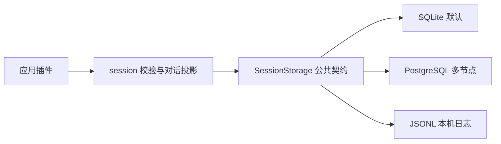

# JSONL 会话存储

`session-jsonl` 是独立的本地文件存储插件，实现 `SessionStorage`。Session 继续负责对话投影，JSONL 插件负责锁、原子提交、回执、恢复及文件资源。应用默认仍选择 SQLite；需要可直接检查的追加日志时，可以明确选择 JSONL。



```ts
import { createHost } from "@x-harness/core";
import type { Result } from "@x-harness/core";
import { createSessionPlugin, session } from "@x-harness/session";
import { createJsonlSessionPlugin } from "@x-harness/session-jsonl";

function configured<T, E>(result: Result<T, E>): T {
  if (!result.ok) throw new Error("Application configuration failed");
  return result.value;
}

const host = configured(createHost());
configured(
  await host.install([
    configured(createJsonlSessionPlugin({ path: "./data/sessions-jsonl" })),
    configured(createSessionPlugin({ namespace: "workspace" })),
  ]),
);
const sessions = configured(host.use(session));
const created = await sessions.create({ id: "chat" });
const appended = created.ok
  ? await sessions.append({
      id: "chat",
      expectedRevision: created.value.revision,
      commitId: "input-1",
      entries: [
        { kind: "message", message: { role: "user", content: [{ type: "text", text: "你好" }] } },
      ],
    })
  : created;
configured(await host.close());
export { appended };
```

默认目录为 `./data/sessions-jsonl`。可选 `limits` 为 `maxQueue: 64`、`lockTimeoutMs: 1000`、`operationTimeoutMs: 10000`，单位为条数或毫秒，正整数，最高为默认值四倍。会话容量由 `createSessionPlugin({ limits })` 配置，并在命名空间持久保存；不同实例必须一致。目录由该插件独占，新目录权限0700、数据文件0600，拒绝符号链接日志、硬链接及无法识别的非空目录。

## 一次写入如何确认

namespace目录及会话文件名使用规范小写base32编码，避免大小写不敏感文件系统上的ID冲突；最长128字节ID仍满足常见文件名长度限制。根格式标记要求paths=base32，不匹配目录拒绝打开且保留原文件。

每个会话一个JSONL文件。记录行后跟提交结束行，摘要覆盖前一提交摘要、全部记录和投影差异。完整结束行和文件、目录同步均成功后才返回成功。同一目录上的实例通过操作系统 `flock` 串行访问；进程死亡由系统释放锁，无需猜测进程是否超时。

取消、超时、磁盘错误或断线可能产生未知结果。保留原 `commitId` 重试，或使用 `getCommit` 查证。`not-found` 只代表此次读取未看到回执。内核在实际I/O结束前仍保留工作及资源，取消不会承诺撤销已开始确认的提交。

重开会校验创建身份、连续序列、容量、投影引用及摘要链。缺少结束行的追加尾部可以截断；完整但无效的行报告 `storage-corrupt`，不会静默删除。分支和日志整理先写临时文件，再同步并原子发布。已发布分支或快照缺少完整基线属于损坏。整理保留所有回执；分支不继承父回执。

列表只解析候选文件的校验头，返回不可变摘要；不为列表重放历史，也不以列表成功承诺正文完整。目录枚举受namespace会话配额约束，所有操作仍在同一系统锁内完成。

## 容量与性能

每实例只有一个串行执行槽和有界等待队列。只缓存最近一个会话的记录偏移、摘要、投影及回执，不缓存全部正文。正常增长增量重放，分页按偏移读取，读取时再次核验记录摘要。切换会话、文件被替换或缩短时重新校验。

投影只追加增删差异，允许旧节点再次加入或改变位置。日志超过当前规范快照编码长度两倍且大于1MiB时自动整理。已膨胀日志必须先整理成功才能继续追加；整理失败不阻止读取完整提交。整理需要临时磁盘空间，部署应同时预留日志和快照空间。领域字节配额不等于物理文件大小，JSON转义、索引、回执和同步都有开销。

## 部署范围

支持 Bun 上的本机 macOS 和 Linux/glibc，通过 Bun FFI 调用系统锁。本机测试实测 macOS；Linux/glibc 的部署需运行同一套验证。Windows、跨机器共享目录、网络文件系统锁和多节点故障切换不在此后端保证范围；多节点部署选择 PostgreSQL 后端。

备份应在关闭所有实例或持有同一存储锁时复制整个目录。不要在运行中编辑日志、替换锁文件或只复制某个正在追加的文件。目录权限与用户授权由可信宿主管理；namespace 本身不是权限边界。

在工作区执行四门，并定向执行 `bun ../../node_modules/vitest/vitest.mjs run --config vitest.config.ts plugins/session-jsonl`。验证包括公共契约、Session投影、短写与同步故障、逐字节断尾、快照整理和真实进程SIGKILL。断电耐久性仍依赖操作系统、文件系统及存储硬件正确兑现同步语义。

锁与运行时依据：[flock(2)](https://www.man7.org/linux/man-pages/man2/flock.2.html)、[Bun FFI](https://bun.sh/docs/runtime/ffi)。
